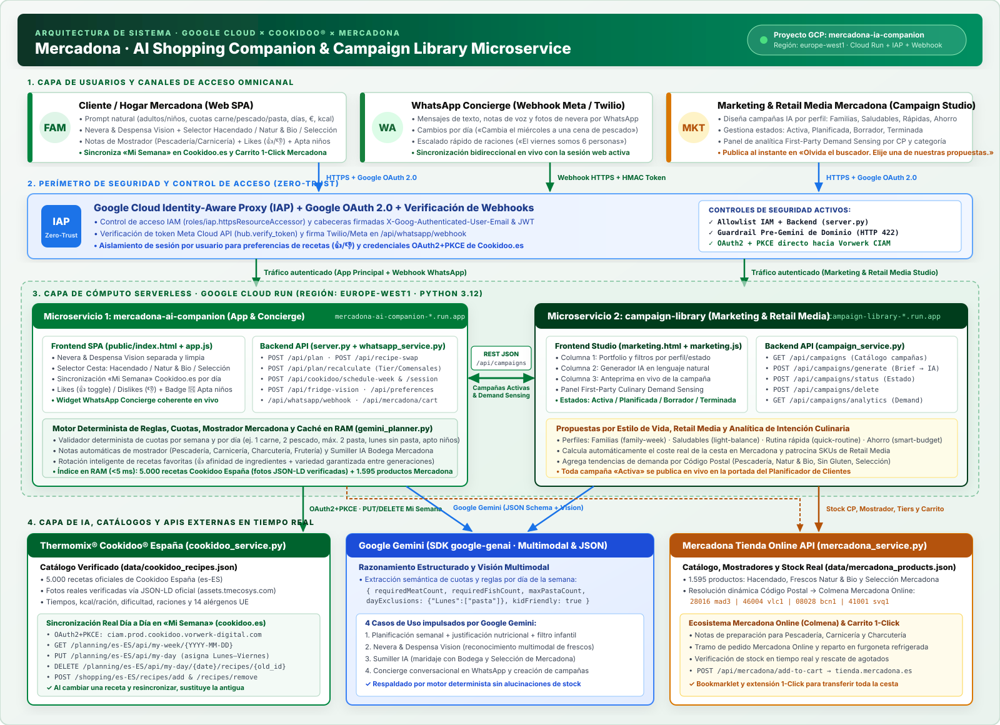
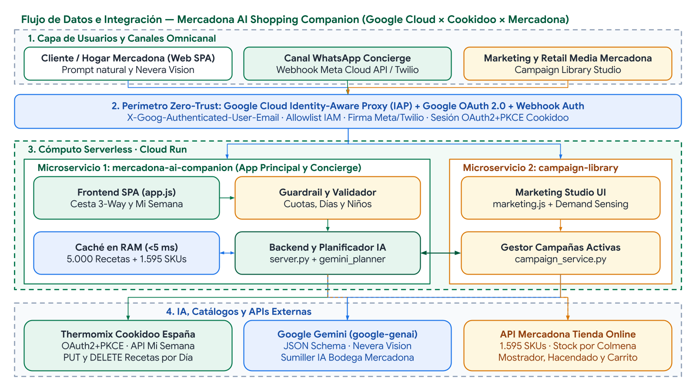

# Mercadona · AI Shopping Companion & Campaign Library (`Google Cloud × Cookidoo® × Mercadona`)

Plataforma omnicanal compuesta por **dos microservicios serverless en Google Cloud Run (`europe-west1`)**, protegidos mediante **Google Cloud Identity-Aware Proxy (IAP)** e impulsados por **Google Gemini**, que conecta el catálogo completo de **5.000 recetas oficiales de Thermomix® (Cookidoo® España)** y su calendario real **«Mi Semana»** con el catálogo, los mostradores tradicionales (*Pescadería, Carnicería, Charcutería, Frutería*), la **Colmena logística** y el carrito en tiempo real de **Mercadona Tienda (`tienda.mercadona.es`)**.

---

## Esquema de Arquitectura



### Flujo de Datos e Integración entre Servicios (Google Drawings)



> 🎨 **Diagrama vectorial editable (Google Drawings / Slides)**: [Abrir y editar formas y conectores en Google Slides / Drawings](https://docs.google.com/presentation/d/1aVnV4gv2O45u2VV_uQPEwPXmS4OL_iOhEv_tjn7Ku8Y/edit) *(puedes seleccionar todos los objetos con `Ctrl+A` / `Cmd+A` y pegarlos directamente en cualquier Google Doc mediante `Insertar > Dibujo`)*.

---

## Componentes y Servicios Utilizados

| Capa | Servicio / Componente | Archivo(s) Clave | Función Principal |
| :--- | :--- | :--- | :--- |
| **Seguridad y Autenticación** | **Google Cloud Identity-Aware Proxy (IAP)** + **Google OAuth 2.0** + **Verificación Webhook** | `server.py`, `campaign_service.py`, `whatsapp_service.py` | Protege los servicios en Cloud Run. Verifica identidad Google (`X-Goog-Authenticated-User-Email`), restringe el acceso a la allowlist autorizada y valida las peticiones entrantes del webhook de WhatsApp (`hub.verify_token` / firma Twilio y Meta Cloud API). |
| **Microservicio Principal** | **`mercadona-ai-companion`** (Cloud Run `europe-west1`) | `server.py`, `gemini_planner.py`, `public/app.js`, `public/index.html` | Experiencia principal del cliente: planificador semanal por lenguaje natural, **Nevera & Despensa Vision**, selector de cesta en 3 niveles (*Hacendado / Frescos Natur & Bio / Selección & Bodega Mercadona + Sumiller IA*), notas de mostrador tradicional, likes/dislikes (`👍`/`👎`), sincronización día a día con **Cookidoo.es** y carrito 1-Click en **Mercadona Online (`tienda.mercadona.es`)**. |
| **Concierge Omnicanal WhatsApp** | **Webhook Real Meta Cloud API + Twilio (`whatsapp_service.py`)** | `whatsapp_service.py`, `server.py`, `public/app.js` | Permite planificar el menú, enviar fotos de la nevera, pedir cambios para un día concreto (*«Cambia el miércoles a una cena de pescado»*), escalar comensales (*«El viernes somos 6»*) y sincronizar con Cookidoo o el carrito de Mercadona desde WhatsApp. |
| **Microservicio de Marketing** | **`campaign-library`** (Cloud Run `europe-west1`) | `campaign_service.py`, `public/marketing.js`, `public/marketing.html`, `data/campaigns.json` | Estudio para el equipo de Marketing y Retail Media de Mercadona: creación de campañas en lenguaje natural por perfil (*Familias*, *Saludables*, *Rutina rápida*, *Ahorro*), gestión de estados (*Activa*, *Planificada*, *Borrador*, *Terminada*) y panel de analítica **First-Party Culinary Demand Sensing**. |
| **Inteligencia Artificial** | **Google Gemini (`google-genai` SDK)** | `gemini_planner.py`, `campaign_service.py`, `whatsapp_service.py` | Extracción semántica estructurada (JSON Schema), reconocimiento visual de ingredientes en **Nevera & Despensa Vision**, **Sumiller IA** para maridajes de *Bodega y Selección Mercadona* y generación de campañas de Marketing. |
| **Recetas y Calendario Thermomix®** | **Cookidoo® España (`cookidoo_service.py`)** | `cookidoo_service.py`, `data/cookidoo_recipes.json` | Catálogo de **5.000 recetas oficiales de Cookidoo España (`es-ES`)** con imágenes reales verificadas desde el JSON-LD oficial (`assets.tmecosys.com`). Autenticación en vivo **OAuth2 + PKCE** contra Vorwerk CIAM y programación día a día (*Lunes a Viernes*) en el calendario **«Mi Semana»** con reemplazo automático de recetas anteriores. |
| **Catálogo, Colmena y Carrito Mercadona** | **Mercadona Tienda Online (`mercadona_service.py`)** | `mercadona_service.py`, `data/mercadona_products.json` | Catálogo de **1.595 productos verificados de Mercadona** (*Hacendado*, *Frescos Natur & Bio*, *Selección & Bodega*), resolución dinámica de código postal a almacén logístico (*Colmena*, ej. `mad3`, `vlc1`, `bcn1`), notas de preparación en mostrador y transferencia de cesta en 1-Click (`POST /api/mercadona/add-to-cart`). |

---

## Funcionalidades Destacadas

### 1. Sincronización Real Día a Día con «Mi Semana» de Cookidoo.es (`OAuth2 + PKCE`)
- **Autenticación directa sin dependencias externas**: [`cookidoo_service.py`](cookidoo_service.py) implementa el flujo completo **OAuth2 Authorization Code + PKCE (`S256`)** contra `https://ciam.prod.cookidoo.vorwerk-digital.com` usando exclusivamente la librería estándar de Python 3.12.
- **Programación por día (`Lunes` a `Viernes`)**: Al confirmar el menú semanal, asigna cada una de las 5 recetas a su fecha ISO exacta (`YYYY-MM-DD`) de la **semana actual** o **próxima semana** mediante `PUT https://cookidoo.es/planning/es-ES/api/my-day`.
- **Sustitución limpia al cambiar de receta y resincronizar**: Dado que `PUT /planning/es-ES/api/my-day` en Cookidoo es aditivo, [`_cookidoo_replace_calendar_day_stdlib`](cookidoo_service.py) consulta previamente `GET /planning/es-ES/api/my-week/{YYYY-MM-DD}` y el resultado de `PUT /my-day`, elimina automáticamente del calendario cualquier receta anterior de ese día vía `DELETE /planning/es-ES/api/my-day/{YYYY-MM-DD}/recipes/{old_id}` y la retira también de la lista de la compra (`POST /shopping/es-ES/recipes/remove`).

### 2. Motor Determinista de Cuotas, Exclusiones por Día, Filtro Infantil (`👶`) y Favoritas (`👍`/`👎`)
- **Cuotas y reglas por día de la semana**: [`parse_constraints`](gemini_planner.py) y [`_enforce_weekly_quotas_and_day_rules`](gemini_planner.py) garantizan determinísticamente peticiones complejas como *«Incluye una cena de carne, dos de pescado, usa la pasta que tengo en casa, no propongas pasta más de dos veces y nunca los lunes»*.
- **Modo Infantil (`👶 Recetas aptas para niños`)**: Se activa automáticamente cuando el hogar incluye niños (`children > 0`) o cuando se solicita en el prompt, filtrando platos con alcohol sin evaporar, picantes, mariscos complejos o sabores fuertes y priorizando recetas suaves con insignia `👶 Apta niños`.
- **Gestión de Favoritas (`👍` / `👎`) con Variedad Garantizada**:
  - Pulsar de nuevo sobre un `👍` activo permite desmarcar el Like en cualquier momento (`vote: "none"`).
  - Las recetas con `👍` aportan afinidad de ingredientes e inspiran futuros menús sin monopolizar siempre el plan semanal (rotación probabilística y exclusión del menú inmediatamente anterior).

### 3. Experiencia Diferencial de Mercadona Online (`tienda.mercadona.es`)
- **Selector de Cesta en 3 Niveles + Sumiller IA**: Alterna en 1 clic entre **Hacendado (Ahorro)**, **Frescos Natur & Bio** y **Selección & Bodega Mercadona**, recalculando precios al instante e incluyendo la recomendación de maridaje del **Sumiller IA**.
- **Notas Automáticas de Mostrador Tradicional**: Genera instrucciones de corte y preparación para **Pescadería** (*limpio sin espinas, en lomos, para horno*), **Carnicería**, **Charcutería** y **Frutería** de Mercadona.
- **Nevera & Despensa Vision**: Analiza fotos de tu nevera/despensa con **Google Gemini Vision** (o mediante presets en 1 clic) y descuenta automáticamente de la cesta los ingredientes que ya tienes en casa.
- **Logística Mercadona Online (Colmena)**: Calcula el progreso del tramo de pedido online, permite escalar comensales en días sueltos (*«Hoy vienen invitados»*) y elegir entre reparto en furgoneta refrigerada o recogida rápida.

### 4. Seguridad, Hardening en Runtime y Control de Acceso (Zero-Trust IAP)
- **Google Cloud IAP + Verificación Criptográfica ES256**: Ambos microservicios (`mercadona-ai-companion` y `campaign-library`) validan la firma criptográfica ES256 del JWT de IAP (`x-goog-iap-jwt-assertion`) en Cloud Run y restringen el acceso a las **5 cuentas autorizadas** (`mgandolfi@google.com`, `mattia.gandolfi@gmail.com`, `juan.roig@mercadona.es`, `paco.espert@mercadona.es`, `mikelju@gmail.com`).
- **Aislamiento Multitenant & Persistencia**: El estado de preferencias (`👍`/`👎`), sesiones de WhatsApp y campañas personalizadas se aísla por usuario autenticado y se persiste en **Google Cloud Storage (GCS)** con escrituras atómicas.
- **Auditoría Completa**: Consulta el informe detallado en [`docs/SECURITY_REVIEW.md`](docs/SECURITY_REVIEW.md).

---

## Ejecución Local

```bash
# 1. Servicio principal (Mercadona AI Shopping Companion) en http://localhost:8080
PYTHONPATH=. python3 -P server.py

# 2. Microservicio de Marketing (Campaign Library Studio) en http://localhost:8081/marketing
PYTHONPATH=. SERVICE_ROLE=marketing PORT=8081 python3 -P server.py

# 3. Ejecutar la suite completa de 321 pruebas unitarias, integración y seguridad
PYTHONPATH=. python3 -P -m unittest discover -s tests -p "test_*.py"
```

## Despliegue en Google Cloud Run (`europe-west1`)

```bash
chmod +x deploy.sh
PROJECT_ID="mercadona-ia-companion" ACCOUNT="mattia@mgandolfi.altostrat.com" REGION="europe-west1" ./deploy.sh
```
