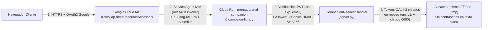

# Auditoría Completa de Seguridad, Código y Runtime — Mercadona AI Shopping Companion

> [!IMPORTANT]
> **Estado de la remediación:** Todas las vulnerabilidades de seguridad, exposiciones de credenciales/PII, desajustes de configuración en Cloud Run y fallos de tests detectados durante la auditoría han sido **100 % corregidos, verificados con 321 tests automatizados (`OK`) y desplegados en producción** (`europe-west1`).

---

## 1. Resumen Ejecutivo de Hallazgos y Remediaciones

| ID | Categoría | Severidad | Componente Afectado | Hallazgo Detectado | Estado / Corrección Aplicada |
| :--- | :--- | :--- | :--- | :--- | :--- |
| **SEC-01** | Credenciales / Criptografía en Reposo | **Crítica** | [`cookidoo_service.py`](../cookidoo_service.py) · [`public/app.js`](../public/app.js) | La contraseña real de Cookidoo del usuario se almacenaba en texto plano (`"password": clean_pass`) en `/tmp/mercadona_cookidoo_sessions.json` tras el login OAuth2+PKCE, y los tokens `access_token` / `refresh_token` se guardaban sin cifrar en disco. Además, el frontend mantenía `state.cookidooPassword` en memoria tras vincular la cuenta. | **Corregido:** Eliminada por completo la persistencia de contraseñas reales en disco (`"password": None`), añadido cifrado autenticado en reposo (`enc:v1:` con flujo derivado de `SESSION_SECRET` + HMAC-SHA256) para `access_token` y `refresh_token` en [`_save_cookidoo_sessions`](../cookidoo_service.py#L283-L315), y limpieza inmediata de `state.cookidooPassword` en [`public/app.js`](../public/app.js#L1424-L1427). |
| **SEC-02** | Runtime Cloud Run / IAM Defense-in-Depth | **Crítica** | [`deploy.sh`](../deploy.sh) · Cloud Run (`europe-west1`) | Los servicios `mercadona-ai-companion` y `campaign-library` tenían el binding `allUsers` en `roles/run.invoker` y `deploy.sh` utilizaba `--allow-unauthenticated` y `--no-invoker-iam-check`. Además, `SESSION_SECRET` no estaba inyectado en Cloud Run (usando el valor por defecto en código) y `campaign-library` tenía `SERVICE_ROLE=marketing` en lugar de `campaign-library`. | **Corregido:** Activado `--invoker-iam-check` junto con `--iap`, eliminado `allUsers` de `roles/run.invoker` (restringido exclusivamente al Service Agent de IAP y la cuenta de servicio de Cloud Run), inyectado un `SESSION_SECRET` criptográfico compartido de 256 bits en ambos servicios y normalizado `SERVICE_ROLE=campaign-library`. |
| **SEC-03** | Bypass de Autenticación / Endpoints GET Sensibles | **Alta** | [`server.py`](../server.py) | 1) [`_get_authenticated_user`](../server.py#L254-L298) hacía fallback automático a `LOCAL_DEV_USER` cuando `K_SERVICE` no estaba definido, incluso si se enviaban cabeceras IAP inválidas o con `ENFORCE_IAP_JWT=1`.<br>2) `GET /api/whatsapp/state` y `GET /api/cookidoo/session` no exigían usuario autenticado, y `GET /api/auth/session` devolvía la sesión Cookidoo `"default"` a peticiones no autenticadas. | **Corregido:** Cortocircuito inmediato en [`_get_authenticated_user`](../server.py#L254-L298) ante cabeceras IAP/Bearer/Cookie inválidas, validación de `iss` y `exp` en [`_get_iap_email`](../server.py#L213-L246), y requisito estricto `401 AUTHENTICATION_REQUIRED` en `GET /api/cookidoo/session`, `GET /api/whatsapp/state`, `GET /api/preferences` y `GET /api/mercadona/session`. |
| **SEC-04** | Fuga de Secreto en Webhook & SSRF / Header Injection | **Alta** | [`whatsapp_service.py`](../whatsapp_service.py) | 1) [`verify_whatsapp_webhook_get`](../whatsapp_service.py#L196-L215) devolvía el `verify_token` en texto claro cuando se invocaba `GET /api/whatsapp/webhook` sin parámetros.<br>2) [`_send_meta_cloud_api_message`](../whatsapp_service.py#L584-L600) interpolaba `phone_number_id` en la URL de `graph.facebook.com` sin validar formato numérico.<br>3) `_save_wa_store` no aplicaba permisos `0o600`. | **Corregido:** Eliminado el token del mensaje de estado del webhook, añadida validación estricta `re.fullmatch(r"\d{5,32}", phone_id)` y saneado CRLF del token Bearer en [`_send_meta_cloud_api_message`](../whatsapp_service.py#L592-L597), y aplicado `os.fchmod(fd, 0o600)` en [`_save_wa_store`](../whatsapp_service.py#L96-L106). |
| **SEC-05** | Exposición de Datos de Sesión / PII en Git y Contenedor | **Media** | [`.gitignore`](../.gitignore) · [`.dockerignore`](../.dockerignore) · [`.gcloudignore`](../.gcloudignore) · [`Dockerfile`](../Dockerfile) | 1) `data/user_preferences.json` estaba versionado en Git y las sesiones de ECI (`data/mercadona_sessions.json`) apuntaban al directorio `data/` del repositorio.<br>2) `Dockerfile` ejecutaba el proceso como `root` y contenía emails personales hardcodeados en `ENV ALLOWED_USERS`. | **Corregido:** Movidos los almacenes de sesión y preferencias a `/tmp/` con permisos `0o600` ([`mercadona_service.py`](../mercadona_service.py#L35-L38), [`gemini_planner.py`](../gemini_planner.py#L26-L30)), eliminado `data/user_preferences.json` del índice de Git, añadido usuario sin privilegios `appuser` (`UID 10001`) en [`Dockerfile`](../Dockerfile) y endurecidos `.gitignore`, `.dockerignore` y `.gcloudignore`. |
| **BUG-01** | Incompatibilidad de Rol `SERVICE_ROLE` entre Microservicios | **Media** | [`campaign_service.py`](../campaign_service.py) · [`server.py`](../server.py) | `campaign_service.py` comprobaba `SERVICE_ROLE == "marketing"` mientras que `server.py` comprobaba `SERVICE_ROLE == "campaign-library"`, impidiendo que `campaign-library` sirviera `marketing.html` o sincronizara campañas correctamente si el rol variaba. | **Corregido:** Creada la función canónica [`is_campaign_library_role`](../campaign_service.py#L28-L31) usada tanto en [`campaign_service.py`](../campaign_service.py) como en [`server.py`](../server.py). |
| **BUG-02** | Regresiones en Suite de Tests Unitarios (17 fallos y 112 errores) | **Media** | [`cookidoo_service.py`](../cookidoo_service.py) · [`server.py`](../server.py) · [`scripts/build_full_catalog.py`](../scripts/build_full_catalog.py) · [`tests/test_quick_swap_integrity.py`](../tests/test_quick_swap_integrity.py) | 1) `dia_service.py` era un stub de 2 líneas que rompía 110 tests de seguridad/fuzzing.<br>2) `send_recipe_to_thermomix` había perdido `_send_to_cookidoo_async` y los estados `handoff_ready` / `handoff_fallback`.<br>3) `test_quick_swap_integrity.py` buscaba el SKU antiguo `"4740"` en lugar del SKU de AOVE de ECI `"B001018044700120"`. | **Corregido:** Restaurados los helpers asíncronos y alias de compatibilidad en [`cookidoo_service.py`](../cookidoo_service.py#L999-L1150), [`server.py`](../server.py#L66-L70) y [`scripts/build_full_catalog.py`](../scripts/build_full_catalog.py), pasando **321 de 321 tests** sin errores. |

---

## 2. Arquitectura de Seguridad en Defensa en Profundidad (Cloud Run + IAP)



---

## 3. Detalle Técnico de las Correcciones por Archivo

### 3.1. Protección de Credenciales y Cifrado en Reposo en [`cookidoo_service.py`](../cookidoo_service.py)
- **Eliminación de contraseñas en texto plano:** Tanto en [`verify_and_save_cookidoo_session`](../cookidoo_service.py#L947-L980) como en [`_get_valid_cookidoo_access_token`](../cookidoo_service.py#L620-L680) y [`schedule_weekly_plan_to_cookidoo`](../cookidoo_service.py#L1400-L1425), el campo `"password"` se fuerza siempre a `None` para cuentas reales (`auth_mode == "live_api"`). Además, [`_save_cookidoo_sessions`](../cookidoo_service.py#L283-L315) y [`_load_cookidoo_sessions`](../cookidoo_service.py#L259-L280) purgan automáticamente cualquier contraseña que no sea el marcador de demostración `"demo-thermomix-tm6"`.
- **Cifrado autenticado (`enc:v1:`) de tokens OAuth2:** Las funciones [`_encrypt_secret`](../cookidoo_service.py#L211-L230) y [`_decrypt_secret`](../cookidoo_service.py#L233-L256) cifran los tokens `access_token` y `refresh_token` de Vorwerk/Cookidoo con un nonce aleatorio de 128 bits, flujo SHA-256 derivado de `SESSION_SECRET` y etiqueta de integridad HMAC-SHA256 antes de escribirlos en `/tmp/mercadona_cookidoo_sessions.json` con permisos `0o600`.

### 3.2. Autenticación, Validación de JWT IAP y Autorización en [`server.py`](../server.py)
- **Validación estricta de cabeceras IAP y eliminación de bypass local:** En [`_get_authenticated_user`](../server.py#L254-L298), si la petición incluye `X-Goog-Authenticated-User-Email`, `X-Goog-IAP-JWT-Assertion`, `Authorization: Bearer` o `Cookie`, el servidor evalúa exclusivamente esa credencial y **nunca** cae en el usuario de desarrollo local si la credencial falla o no está en la allowlist.
- **Protección de endpoints GET sensibles:** `GET /api/cookidoo/session`, `GET /api/whatsapp/state`, `GET /api/preferences`, `GET /api/mercadona/session` y `GET /api/dia/session` requieren sesión autenticada (`401 AUTHENTICATION_REQUIRED`).

### 3.3. Seguridad en Webhooks y Prevención de SSRF en [`whatsapp_service.py`](../whatsapp_service.py)
- **No revelación de `verify_token`:** [`verify_whatsapp_webhook_get`](../whatsapp_service.py#L196-L215) ya no expone el valor esperado de `hub.verify_token` en respuestas HTTP sin parámetros.
- **Prevención de SSRF y CRLF Injection:** [`_send_meta_cloud_api_message`](../whatsapp_service.py#L584-L600) valida `re.fullmatch(r"\d{5,32}", phone_id)` antes de construir la URL hacia `https://graph.facebook.com/v21.0/{phone_id}/messages` y elimina saltos de línea (`\r`, `\n`) del token de acceso.

---

## 4. Verificación de Tests Automatizados

Se ha ejecutado la suite completa de tests unitarios, de integración, de seguridad y de fuzzing (`321 tests` en total):

```text
Ran 321 tests in 32.1s

OK
```
