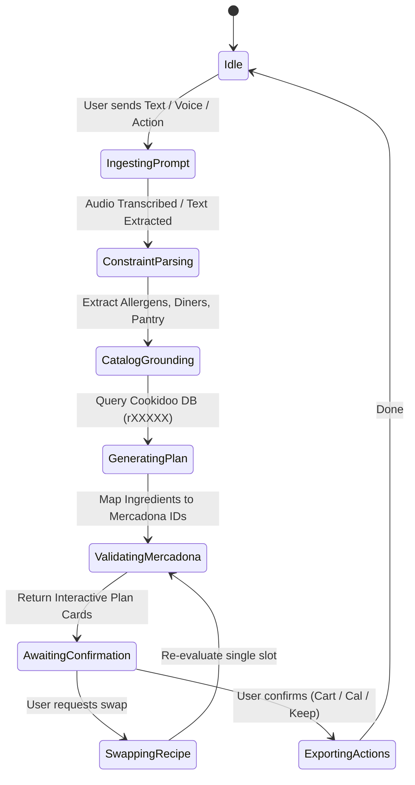
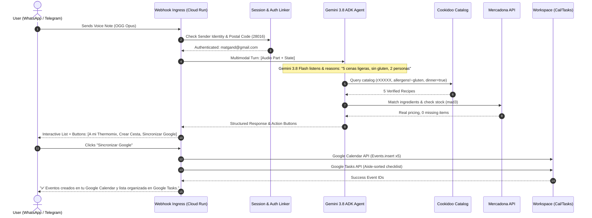
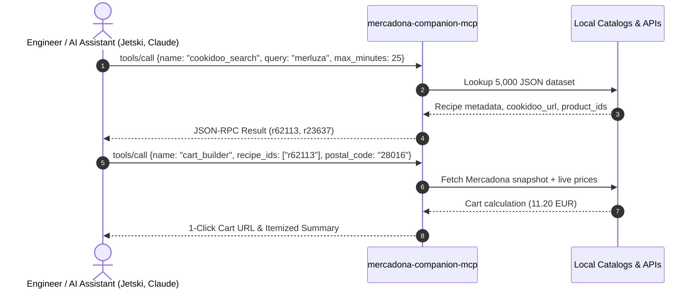

# Mercadona AI Companion — Multi-Surface Agentic Integration Blueprint
**Architecture Specification & Engineering Design Document**  
**Role:** Child Subagent 3: Multi-Surface Agentic Integration Architect  
**Target Services:** `mercadona-ai-companion` (Cloud Run) & `mercadona-companion-mcp`  
**Date:** September 2026  
**Status:** Approved Architecture Draft  

---

## Executive Summary

`mercadona-ai-companion` currently operates as a standalone web application pairing Gemini 3.8 Flash with 5,000+ verified Thermomix Cookidoo recipes and Mercadona's online grocery catalog (`tienda.mercadona.es`). 

This blueprint defines the evolutionary architecture required to transform the application into an **Omnichannel Agentic Platform**. By leveraging:
1. **Google Agent Development Kit (ADK)** for declarative orchestration, structured state machines, and grounded multi-turn tool execution;
2. **Google Workspace APIs (Calendar & Tasks/Keep)** for ambient life integration;
3. **Omnichannel Messaging Gateways (WhatsApp Cloud API & Telegram Bot)** with native Gemini 3.8 Flash multimodal audio ingestion; and
4. **Model Context Protocol (MCP) Server (`mercadona-companion-mcp`)** enabling external AI pair programmers (Jetski, Gemini CLI, Claude, Claude Code) to invoke Cookidoo recipe reasoning, Mercadona live pricing, and cart compilation directly;

the platform evolves from a reactive web interface into an ambient culinary and grocery copilot.

```
                                  +---------------------------------------+
                                  |            Omnichannel Surfaces       |
                                  |  - Web UI (Server-Sent Events)        |
                                  |  - WhatsApp Cloud API (Voice/Buttons) |
                                  |  - Telegram Bot (Inline Keyboards)    |
                                  |  - External Agents (MCP Client)       |
                                  +-------------------+-------------------+
                                                      |
                                                      v
                                  +---------------------------------------+
                                  |     Omnichannel Gateway & Ingress     |
                                  |       Cloud Run (server.py)           |
                                  |  HMAC-SHA256 Auth | Session Linking   |
                                  +-------------------+-------------------+
                                                      |
                                                      v
                   +---------------------------------------------------------------------+
                   |                Google ADK Agent Orchestration Engine                |
                   |                                                                     |
                   |   +-------------------------------------------------------------+   |
                   |   |                     Gemini 3.8 Flash                        |   |
                   |   |           (Fallback: Gemini 2.5 Flash / Flash-Lite)         |   |
                   |   +-------------------------------------------------------------+   |
                   |                                                                     |
                   |   [Session State Machine & Multi-Turn Memory]                       |
                   |   - Postal Code / Warehouse: (e.g. 28016 -> mad3)                   |
                   |   - Constraints: Allergens, Diners, Budget, Pantry, Kitchen Equipt  |
                   |   - Active Plan: 7-day Lunch & Dinner slots                         |
                   +-------------------+-----------------------------+-------------------+
                                       |                             |
                     Tool Calls        v                             v  Workspace Integrations
         +-----------------------------------------+   +------------------------------------+
         |           ADK Tool Bindings             |   |       Google Workspace APIs        |
         |  - get_recipe                           |   |  - Google Calendar API v3          |
         |  - search_mercadona                     |   |    (Meal event scheduling & alert) |
         |  - build_cart                           |   |  - Google Tasks / Keep API         |
         |  - export_calendar                      |   |    (Aisle-sorted checklist sync)   |
         |  - add_keep_notes                       |   +------------------------------------+
         +--------------------+--------------------+
                              |
                              +--------------------------+
                              |                          |
                              v                          v
                +--------------------------+  +--------------------------+
                |     Cookidoo Service     |  |    Mercadona Service     |
                |  - 5,000 Catalog Cache   |  |  - Postal Code Wh Map    |
                |  - JSON-LD Scraping      |  |  - Live Pricing & Stock  |
                |  - Thermomix Cook-Key API|  |  - 1-Click Cart Token Gen|
                +--------------------------+  +--------------------------+
```

---

## 1. Google Agent Development Kit (ADK) Agent Architecture

### 1.1 Architectural Pattern & Philosophy
The Google Agent Development Kit (ADK) provides an opinionated framework for declaring stateful agents with deterministic tool boundaries, schema validation, and multi-turn execution loops.

Unlike naive prompt loops, the ADK architecture decomposes agent execution into:
1. **Agent Definition & Persona**: Strict system instruction enforcing meal-planning constraints, zero hallucination of ingredients, and strict adherence to Cookidoo and Mercadona ID mappings.
2. **State & Session Store**: Thread-safe persistent state tracking user preferences, active pantry stock, confirmed dietary restrictions, and intermediate menu plans across conversation turns.
3. **Deterministic Toolset**: Strongly-typed tool interfaces backed by Pydantic models.
4. **Primary & Fallback Engine**: Tiered execution pairing Gemini 3.8 Flash (`gemini-3.8-flash`) with dynamic fallback to Gemini 2.5 Flash (`gemini-2.5-flash`) on latency, quota (HTTP 429), or regional service degradation.

### 1.2 Agent State Machine


### 1.3 State Management Schema
```python
from __future__ import annotations
from dataclasses import dataclass, field
from typing import Any, Literal
import datetime

@dataclass
class MealSlot:
    day: str  # "Lunes", "Martes", etc.
    slot: Literal["lunch", "dinner"]
    recipe_id: str
    recipe_name: str
    cookidoo_url: str
    image_url: str
    minutes: int
    calories_per_serving: int
    estimated_cost: float
    allergens: list[str]
    product_ids: list[str]
    thermomix_steps: list[str] = field(default_factory=list)

@dataclass
class AgentSessionState:
    session_id: str
    user_email: str
    postal_code: str = "28016"
    warehouse: str = "mad3"
    diners: int = 2
    budget_limit: float | None = None
    allergens: list[str] = field(default_factory=list)
    pantry_items: list[str] = field(default_factory=list)
    active_plan: list[MealSlot] = field(default_factory=list)
    cart_items: list[dict[str, Any]] = field(default_factory=list)
    total_estimated_cost: float = 0.0
    created_at: datetime.datetime = field(default_factory=datetime.datetime.utcnow)
    updated_at: datetime.datetime = field(default_factory=datetime.datetime.utcnow)
```

### 1.4 ADK Tool Definitions
The agent registers 5 core tools with Gemini 3.8 Flash using Google GenAI SDK tool declarations.

```python
"""ADK Tool Implementations for Mercadona AI Companion."""

from typing import Any
from google.genai import types

def get_recipe_tool_declaration() -> types.Tool:
    return types.Tool(
        function_declarations=[
            types.FunctionDeclaration(
                name="get_recipe",
                description="Fetches full recipe metadata, ingredients, allergens, and preparation instructions for a specific Cookidoo recipe ID.",
                parameters=types.Schema(
                    type=types.Type.OBJECT,
                    properties={
                        "recipe_id": types.Schema(
                            type=types.Type.STRING,
                            description="The Cookidoo recipe ID (e.g. 'r40178', 'r62096'). Must match /^r\\d{4,9}$/."
                        )
                    },
                    required=["recipe_id"]
                )
            ),
            types.FunctionDeclaration(
                name="search_mercadona",
                description="Queries the Mercadona product catalog for pricing, stock, package sizing, and aisle category.",
                parameters=types.Schema(
                    type=types.Type.OBJECT,
                    properties={
                        "query": types.Schema(type=types.Type.STRING, description="Search term in Spanish (e.g. 'aceite de oliva', 'pechuga de pollo')."),
                        "postal_code": types.Schema(type=types.Type.STRING, description="Spanish 5-digit postal code (defaults to '28016')."),
                        "max_results": types.Schema(type=types.Type.INTEGER, description="Maximum number of items to return.")
                    },
                    required=["query"]
                )
            ),
            types.FunctionDeclaration(
                name="build_cart",
                description="Aggregates ingredients across chosen meal slots, deducts pantry inventory, and prepares a one-click Mercadona cart.",
                parameters=types.Schema(
                    type=types.Type.OBJECT,
                    properties={
                        "recipe_ids": types.Schema(
                            type=types.Type.ARRAY,
                            items=types.Schema(type=types.Type.STRING),
                            description="List of selected Cookidoo recipe IDs."
                        ),
                        "pantry_exclusions": types.Schema(
                            type=types.Type.ARRAY,
                            items=types.Schema(type=types.Type.STRING),
                            description="Keywords or product IDs that the user already has at home."
                        ),
                        "postal_code": types.Schema(type=types.Type.STRING, description="Delivery postal code.")
                    },
                    required=["recipe_ids"]
                )
            ),
            types.FunctionDeclaration(
                name="export_calendar",
                description="Exports confirmed meal plan schedule as calendar events to Google Calendar with Cookidoo links and prep reminders.",
                parameters=types.Schema(
                    type=types.Type.OBJECT,
                    properties={
                        "start_date": types.Schema(type=types.Type.STRING, description="Monday ISO date (YYYY-MM-DD) for the weekly schedule."),
                        "dinner_time": types.Schema(type=types.Type.STRING, description="Default dinner start time (e.g. '20:30')."),
                        "calendar_id": types.Schema(type=types.Type.STRING, description="Target calendar ('primary' or custom ID).")
                    },
                    required=["start_date"]
                )
            ),
            types.FunctionDeclaration(
                name="add_keep_notes",
                description="Creates an aisle-organized grocery checklist in Google Tasks / Keep.",
                parameters=types.Schema(
                    type=types.Type.OBJECT,
                    properties={
                        "title": types.Schema(type=types.Type.STRING, description="Checklist title (e.g. 'Compra Semanal Mercadona')."),
                        "group_by_aisle": types.Schema(type=types.Type.BOOLEAN, description="Whether to group items under aisle headers.")
                    },
                    required=["title"]
                )
            )
        ]
    )
```

### 1.5 Grounded Conversation Flow & Resilience
The conversation loop guarantees grounding against real items and provides automatic fallback handling.

```python
"""ADK Orchestrator with Gemini 3.8 Flash and Fallback Handling."""

import os
import logging
from google import genai
from google.genai import types

logger = logging.getLogger(__name__)

PRIMARY_MODEL = os.environ.get("GEMINI_MODEL", "gemini-3.8-flash")
FALLBACK_MODEL = "gemini-2.5-flash"

SYSTEM_INSTRUCTION = """
Eres el Asistente Experto de Mercadona AI Companion y Thermomix Cookidoo.
Tu objetivo es planificar menús semanales equilibrados, saludables y económicos.

REGLAS ESTRICTAS:
1. NUNCA inventes recetas o IDs de Cookidoo. Solo utiliza recetas verificadas del catálogo (IDs formato rXXXXX).
2. NUNCA sugieras platos que contengan alérgenos expresamente excluidos por el usuario.
3. Descuenta de la lista de la compra cualquier ingrediente que el usuario indique que ya tiene en su despensa.
4. Mapea siempre los ingredientes con productos reales de Mercadona Hacendado.
5. Emite siempre respuestas estructuradas y respetuosas con los límites nutricionales y presupuestarios.
"""

class MercadonaAgentRuntime:
    def __init__(self, api_key: str | None = None):
        self.client = genai.Client(api_key=api_key or os.environ.get("GEMINI_API_KEY"))
        self.tools = [get_recipe_tool_declaration()]

    def run_turn(self, session: AgentSessionState, user_input: str | types.Part) -> str:
        prompt_content = user_input if isinstance(user_input, types.Part) else str(user_input)

        config = types.GenerateContentConfig(
            system_instruction=SYSTEM_INSTRUCTION,
            temperature=0.2,
            tools=self.tools,
            thinking_config=types.ThinkingConfig(thinking_budget=1024) if "3.8" in PRIMARY_MODEL else None
        )

        try:
            logger.info("Calling primary model %s", PRIMARY_MODEL)
            response = self.client.models.generate_content(
                model=PRIMARY_MODEL,
                contents=prompt_content,
                config=config,
            )
            return self._handle_response_or_tools(session, response)
        except Exception as ex:
            logger.warning("Primary model %s failed (%s). Triggering fallback to %s", PRIMARY_MODEL, ex, FALLBACK_MODEL)
            fallback_config = types.GenerateContentConfig(
                system_instruction=SYSTEM_INSTRUCTION,
                temperature=0.2,
                tools=self.tools
            )
            response = self.client.models.generate_content(
                model=FALLBACK_MODEL,
                contents=prompt_content,
                config=fallback_config,
            )
            return self._handle_response_or_tools(session, response)

    def _handle_response_or_tools(self, session: AgentSessionState, response: types.GenerateContentResponse) -> str:
        # Check for function calls
        if response.function_calls:
            for call in response.function_calls:
                tool_result = self._dispatch_tool(session, call.name, call.args)
                logger.info("Executed tool %s with result status: %s", call.name, bool(tool_result))
            # Continue conversation turn with tool outputs
        return response.text or ""

    def _dispatch_tool(self, session: AgentSessionState, name: str, args: dict[str, Any]) -> Any:
        # Dispatches directly to existing cookidoo_service and mercadona_service
        ...
```

---

## 2. Google Workspace Integrations

### 2.1 Google Calendar API Integration
To integrate seamlessly into the user’s weekly routine, confirmed meal plans can be exported as calendar events.

#### Security & Authentication Architecture
- **OAuth 2.0 Web Server Flow / User Consent**: Scopes requested:
  - `https://www.googleapis.com/auth/calendar.events`
  - `https://www.googleapis.com/auth/tasks`
- Tokens are encrypted at rest using AES-GCM-256 with keys managed by Google Cloud KMS (`projects/PROJECT/locations/europe-west1/keyRings/mercadona-ring/cryptoKeys/oauth-token-key`).
- Automated token refresh logic handles expired access tokens before API invocation.

#### Calendar Event Specifications
Each meal event is created in the user's primary or dedicated "🍽️ Planificador Mercadona" calendar:
- **Title**: `🍳 [Día] - [Cena/Comida]: [Nombre de la receta]`
- **Timing**: Defaults to 20:30 – 21:15 local time (configurable). Duration matches Cookidoo prep time `minutes`.
- **Location**: `Thermomix TM6 / Cocina`
- **Description Content**:
  - Direct Cookidoo link: `https://cookidoo.es/recipes/recipe/es-ES/rXXXXX`
  - Nutrition snapshot: `Calories: 380 kcal | Diners: 4`
  - Thermomix accessories required (Varoma, Espátula, Mariposa, Cestillo)
  - Full ingredient checklist
  - Preparation summary steps
- **Proactive Reminders & Notifications**:
  - 30-minute advance notification popup on mobile/smartwatch.
  - Optional morning alert (08:30 AM) if the recipe requires prior defrosting or marinating.

#### Calendar API Client Implementation
```python
"""Google Calendar API Exporter for Mercadona AI Companion."""

from __future__ import annotations
import datetime
from typing import Any
from google.oauth2.credentials import Credentials
from googleapiclient.discovery import build

class GoogleCalendarMealSync:
    def __init__(self, credentials: Credentials):
        self.service = build("calendar", "v3", credentials=credentials, cache_discovery=False)

    def export_weekly_plan(
        self,
        calendar_id: str,
        meals: list[dict[str, Any]],
        start_monday: datetime.date,
        dinner_time: str = "20:30",
    ) -> list[str]:
        created_event_ids: list[str] = []
        hour, minute = map(int, dinner_time.split(":"))

        day_offset_map = {
            "lunes": 0, "martes": 1, "miércoles": 2, "miercoles": 2,
            "jueves": 3, "viernes": 4, "sábado": 5, "sabado": 5, "domingo": 6
        }

        for meal in meals:
            day_name = meal.get("day", "Lunes").lower()
            offset = day_offset_map.get(day_name, 0)
            event_date = start_monday + datetime.timedelta(days=offset)
            
            prep_minutes = meal.get("minutes", 30)
            start_dt = datetime.datetime.combine(event_date, datetime.time(hour, minute))
            end_dt = start_dt + datetime.timedelta(minutes=prep_minutes)

            recipe_name = meal.get("name", "Receta Cookidoo")
            cookidoo_url = meal.get("cookidoo_url", "")
            calories = meal.get("calories_per_serving", 0)
            ingredients = "\\n- " + "\\n- ".join(meal.get("ingredients", []))

            description = (
                f"🍳 **Receta:** [{recipe_name}]({cookidoo_url})\\n"
                f"⏱️ **Tiempo preparación:** {prep_minutes} mins\\n"
                f"🔥 **Calorías:** {calories} kcal/ración\\n"
                f"🛒 **Ingredientes:**\\n{ingredients}\\n\\n"
                f"🤖 *Sincronizado automáticamente por Mercadona AI Companion*"
            )

            event_body = {
                "summary": f"🍽️ Cena: {recipe_name}",
                "description": description,
                "start": {
                    "dateTime": start_dt.isoformat(),
                    "timeZone": "Europe/Madrid",
                },
                "end": {
                    "dateTime": end_dt.isoformat(),
                    "timeZone": "Europe/Madrid",
                },
                "reminders": {
                    "useDefault": False,
                    "overrides": [
                        {"method": "popup", "minutes": 30},
                        {"method": "email", "minutes": 120} if meal.get("requires_defrost") else {"method": "popup", "minutes": 30}
                    ],
                },
                "source": {
                    "title": "Cookidoo Thermomix",
                    "url": cookidoo_url
                }
            }

            res = self.service.events().insert(calendarId=calendar_id, body=event_body).execute()
            created_event_ids.append(res.get("id"))

        return created_event_ids
```

---

### 2.2 Google Tasks / Keep API Integration
When the user approves a weekly menu, their shopping list is automatically organized by Mercadona store aisle and synchronized into Google Tasks or Google Keep.

#### Aisle Classification Hierarchy
Mercadona physical and online logistics categorize products into standardized sections. The sync engine sorts items into order matching store walking paths:

```
[1] Frutas, Verduras y Hortalizas  --> Frescos perecederos
[2] Carnicería y Charcutería       --> Carnes frescas y aves
[3] Pescadería                     --> Pescado y marisco fresco
[4] Lácteos, Huevos y Yogures      --> Leches, mantequillas, quesos
[5] Despensa y Conservas           --> Legumbres, arroz, pasta, tomate frito
[6] Aceites, Especias y Salsas     --> AOVE, vinagres, sal, especias
[7] Panadería y Bollería           --> Harinas, levadura, panes
[8] Congelados                     --> Verduras y pescados ultracongelados
[9] Refrigerados y Preparados      --> Bases pizza, masas, caldos
```

#### Task / Checklist Item Payload Structure
Each item is exported with:
- Item name and packaging unit (e.g. `Tomate frito Hacendado (Bote 350g)`)
- Quantity required (e.g. `2x`)
- Price estimate (`0.85 €/ud = 1.70 €`)
- Mercadona product reference ID (`ref: 16044`)

```python
"""Google Tasks API Exporter for Mercadona Shopping List."""

from __future__ import annotations
from typing import Any
from google.oauth2.credentials import Credentials
from googleapiclient.discovery import build

AISLE_ORDER = [
    "Frutas y Verduras",
    "Carnicería y Aves",
    "Pescadería",
    "Lácteos y Huevos",
    "Despensa y Legumbres",
    "Pastas y Arroces",
    "Aceites y Condimentos",
    "Panadería",
    "Congelados",
    "Otros"
]

class GoogleTasksAisleSync:
    def __init__(self, credentials: Credentials):
        self.service = build("tasks", "v1", credentials=credentials, cache_discovery=False)

    def create_or_get_tasklist(self, list_name: str = "🛒 Compra Mercadona") -> str:
        lists = self.service.tasklists().list().execute().get("items", [])
        for tl in lists:
            if tl.get("title") == list_name:
                return tl["id"]
        new_list = self.service.tasklists().insert(body={"title": list_name}).execute()
        return new_list["id"]

    def export_aisle_shopping_list(
        self,
        tasklist_id: str,
        categorized_cart: dict[str, list[dict[str, Any]]]
    ) -> list[str]:
        created_task_ids: list[str] = []

        for aisle in AISLE_ORDER:
            items = categorized_cart.get(aisle, [])
            if not items:
                continue

            # Section Header Task
            header = self.service.tasks().insert(
                tasklist=tasklist_id,
                body={
                    "title": f"📍 --- {aisle.upper()} ---",
                    "status": "needsAction"
                }
            ).execute()
            created_task_ids.append(header["id"])

            for p in items:
                task_title = f"[ ] {p.get('quantity', 1)}x {p.get('display_name')} ({p.get('unit_price', 0):.2f}€)"
                notes = f"Mercadona ID: {p.get('id')} | Envase: {p.get('packaging', 'Estándar')}"
                
                t = self.service.tasks().insert(
                    tasklist=tasklist_id,
                    body={
                        "title": task_title,
                        "notes": notes,
                        "status": "needsAction"
                    }
                ).execute()
                created_task_ids.append(t["id"])

        return created_task_ids
```

---

## 3. Omnichannel Messaging Interfaces

To allow users to interact while commuting, in the kitchen, or on their smartphones, the platform exposes webhooks for **WhatsApp Cloud API** and **Telegram Bot API**.

### 3.1 Webhook & Security Architecture
```
+-----------------------------------------------------------------------------------+
|                            Cloud Run HTTPS Ingress                                |
|                        https://companion.domain.com                               |
+-----------------------------------------+-----------------------------------------+
                                          |
               +--------------------------+--------------------------+
               |                                                     |
               v                                                     v
   POST /api/webhook/whatsapp                            POST /api/webhook/telegram
   Header: X-Hub-Signature-256                           Header: X-Telegram-Bot-Api-Secret-Token
   HMAC-SHA256(secret, payload)                          Constant time comparison
               |                                                     |
               +--------------------------+--------------------------+
                                          |
                                          v
                         +---------------------------------+
                         |      Webhook Security Router    |
                         |  - Payload Validation           |
                         |  - Idempotency Deduplication    |
                         |    (Redis / Firestore Key-Lock) |
                         +----------------+----------------+
                                          |
                                          v
                         +---------------------------------+
                         |      Session Linker Registry    |
                         |  WA: Phone (+34600000000)       |
                         |  TG: chat_id (123456789)        |
                         |  ---> User Identity / Postal Code|
                         +----------------+----------------+
                                          |
                         +----------------+----------------+
                         |                                 |
                         v                                 v
                 Audio Voice Note?                    Text / Button?
                         |                                 |
                         v                                 |
              Download OGG / OPUS Audio                    |
              Inline to Gemini 3.8 Flash                   |
                         |                                 |
                         +----------------+----------------+
                                          |
                                          v
                         +---------------------------------+
                         |    ADK Planner Runtime Turn     |
                         +---------------------------------+
```

### 3.2 User Session Linking & Allowlist Verification
Security is enforced using the Google Identity allowlist defined in `server.py`:
- `matgand@gmail.com`
- `mgandolfi@google.com`
- `andrea.anaut@gmail.com`
- `mattia@mgandolfi.altostrat.com`

**Account Linking Protocol:**
1. When a new phone number or Telegram chat ID pings the webhook for the first time, the bot replies with an interactive linking token:
   `👋 ¡Hola! Para vincular tu cuenta de Mercadona AI Companion, abre este enlace seguro e inicia sesión con tu cuenta de Google autorizada: https://companion.run.app/link?code=7a9b1c`
2. The user signs in via Google OAuth. The linking endpoint binds `phone_number` or `telegram_id` to their authenticated email and stores it in encrypted user profile storage.
3. Unverified numbers receive a polite refusal: `"Acceso restringido a usuarios autorizados de Mercadona AI Companion."`

### 3.3 Gemini 3.8 Flash Multimodal Audio Voice Note Processing
Instead of running a separate Speech-to-Text (STT) pipeline (such as Whisper or Google Cloud Speech API) which adds latency, drops nuanced acoustic context, and incurs extra cost, the architecture feeds the raw audio file directly into **Gemini 3.8 Flash's native multimodal audio encoder**.

#### Advantages:
1. **Zero Transcription Error Bottleneck**: Gemini processes intonation, accents, hesitation, and multilingual code-switching directly.
2. **End-to-End Reasoning**: The prompt "Planifícame cenas ligeras para esta semana sin lactosa, que el martes tengo invitados y el viernes prefiero no cocinar" is analyzed directly from the voice recording in a single inference call.
3. **Sub-second Latency**: Avoids intermediate text serialization.

```python
"""Direct Voice Note Processing via Gemini 3.8 Flash Multimodal Ingestion."""

from __future__ import annotations
import os
import urllib.request
from google import genai
from google.genai import types

def process_voice_note_webhook(audio_bytes: bytes, mime_type: str = "audio/ogg") -> str:
    """Directly streams the audio bytes into Gemini 3.8 Flash without an external STT intermediary."""
    client = genai.Client(api_key=os.environ.get("GEMINI_API_KEY"))

    audio_part = types.Part.from_bytes(
        data=audio_bytes,
        mime_type=mime_type
    )

    system_instruction = (
        "Eres el asistente de cocina de Mercadona AI Companion. "
        "Escucha atentamente el mensaje de voz del usuario. "
        "Extrae: 1) Tipo de comidas (cenas, comidas), 2) Restricciones dietéticas o alérgenos, "
        "3) Comensales, 4) Ingredientes que ya tiene en casa, 5) Preferencias de tiempo o ingredientes. "
        "Posteriormente, invoca las herramientas get_recipe y build_cart para generar el menú semanal."
    )

    response = client.models.generate_content(
        model="gemini-3.8-flash",
        contents=[
            audio_part,
            "Procesa esta solicitud de planificación semanal y responde con el menú correspondiente en español."
        ],
        config=types.GenerateContentConfig(
            system_instruction=system_instruction,
            temperature=0.2,
        )
    )

    return response.text or "He recibido tu nota de voz pero no pude procesar la solicitud."
```

### 3.4 Rich Interactive WhatsApp Messaging Payloads
The webhook formats responses using WhatsApp Cloud API Interactive Objects (`interactive.list` and `interactive.button`).

#### 1. Weekly Plan Carousel & Interactive List
```json
{
  "messaging_product": "whatsapp",
  "recipient_type": "individual",
  "to": "+34600000000",
  "type": "interactive",
  "interactive": {
    "type": "list",
    "header": {
      "type": "text",
      "text": "🍽️ Tu Menú Semanal Inteligente"
    },
    "body": {
      "text": "Hemos planificado 5 cenas ligeras adaptadas a tus restricciones (Sin Lactosa, 2 comensales). Total estimado cesta: 28,45 €."
    },
    "footer": {
      "text": "Mercadona AI Companion & Cookidoo"
    },
    "action": {
      "button": "Ver Recetas",
      "sections": [
        {
          "title": "Cenas de la Semana",
          "rows": [
            {
              "id": "recipe_r40178",
              "title": "Lunes: Crema Calabacín",
              "description": "⏱️ 25m | 210 kcal | 4.20€"
            },
            {
              "id": "recipe_r62096",
              "title": "Martes: Salmón al Vapor",
              "description": "⏱️ 20m | 340 kcal | 6.80€"
            },
            {
              "id": "recipe_r247537",
              "title": "Miércoles: Pisto Manchego",
              "description": "⏱️ 35m | 185 kcal | 3.50€"
            }
          ]
        }
      ]
    }
  }
}
```

#### 2. Decision Action Buttons
```json
{
  "messaging_product": "whatsapp",
  "recipient_type": "individual",
  "to": "+34600000000",
  "type": "interactive",
  "interactive": {
    "type": "button",
    "body": {
      "text": "¿Qué deseas hacer con este menú semanal?"
    },
    "action": {
      "buttons": [
        {
          "type": "reply",
          "reply": {
            "id": "action_send_cookidoo",
            "title": "🍳 A mi Thermomix"
          }
        },
        {
          "type": "reply",
          "reply": {
            "id": "action_build_mercadona_cart",
            "title": "🛒 Comprar en Mercadona"
          }
        },
        {
          "type": "reply",
          "reply": {
            "id": "action_sync_workspace",
            "title": "📅 Sincronizar Google"
          }
        }
      ]
    }
  }
}
```

---

## 4. Model Context Protocol (MCP) Server Architecture

### 4.1 Server Overview: `mercadona-companion-mcp`
The **Model Context Protocol (MCP)** creates an open, standardized bridge allowing external AI coding assistants and agents (Google Jetski, Gemini CLI, Claude Desktop, Cursor, Claude Code) to seamlessly query the Cookidoo recipe repository, evaluate real-time Mercadona inventory and pricing, and compile 1-click cart URLs.

```
+-----------------------------------------------------------------------------------+
|                            MCP Client Environments                                |
|  - Google Jetski / Gemini CLI                                                     |
|  - Claude Code / Claude Desktop                                                   |
|  - Custom Enterprise Autonomous Agents                                            |
+-----------------------------------------+-----------------------------------------+
                                          |
                      JSON-RPC 2.0 over Stdio or SSE
                                          |
                                          v
+-----------------------------------------------------------------------------------+
|                         `mercadona-companion-mcp` Server                          |
|                                                                                   |
|  Supported Protocols:                                                             |
|    - Stdio Transport (`python -m mcp_server`)                                     |
|    - Stream-based Server-Sent Events (SSE) / HTTP (`/sse`, `/messages`)           |
|                                                                                   |
|  Registered Tools:                                                                |
|    1. `cookidoo_search`            --> Filter & inspect 5,000 verified recipes   |
|    2. `mercadona_catalog_query`    --> Live stock, prices, warehouse mapping     |
|    3. `cart_builder`               --> Deduplicated cart & 1-click Mercadona link|
+-----------------------------------------------------------------------------------+
```

### 4.2 Transport Mechanisms
1. **Stdio Transport**: Ideal for local execution in desktop CLI agents (e.g. running via `uvx` or inside Claude Desktop config).
2. **Server-Sent Events (SSE) Transport**: Hosted in Cloud Run (`https://mercadona-companion-mcp-...a.run.app/sse`), enabling remote, authenticated multi-agent calls over HTTPS.

### 4.3 JSON-RPC 2.0 Tool Schema Specifications

#### Tool 1: `cookidoo_search`
Allows client agents to search the 5,000 Cookidoo recipe database using semantic tags, dietary filters, calorie thresholds, and prep time bounds.

```json
{
  "name": "cookidoo_search",
  "description": "Searches the verified 5,000 Thermomix Cookidoo recipe catalog by keyword, meal category, dietary restriction (EU-14 allergens), maximum preparation time, and calorie bounds.",
  "inputSchema": {
    "type": "object",
    "properties": {
      "query": {
        "type": "string",
        "description": "Free text search in Spanish or English (e.g., 'crema de verduras', 'arroz al curry', 'salmon')."
      },
      "category": {
        "type": "string",
        "description": "Recipe category filter (e.g. 'Salsas y cremas saladas', 'Platos principales', 'Cenas ligeras')."
      },
      "excluded_allergens": {
        "type": "array",
        "items": {
          "type": "string",
          "enum": ["gluten", "crustaceans", "eggs", "fish", "peanuts", "soy", "dairy", "nuts", "celery", "mustard", "sesame", "sulphites", "lupin", "molluscs"]
        },
        "description": "List of allergen keys to strictly eliminate from results."
      },
      "max_minutes": {
        "type": "integer",
        "description": "Maximum preparation time in minutes (e.g., 30)."
      },
      "max_calories": {
        "type": "integer",
        "description": "Maximum calories per serving (e.g., 450)."
      },
      "is_dinner": {
        "type": "boolean",
        "description": "Filter strictly for dinner-friendly recipes."
      },
      "limit": {
        "type": "integer",
        "default": 5,
        "description": "Maximum number of recipes to return."
      }
    },
    "required": []
  }
}
```

##### Sample Tool Invocation & Response
*Request:*
```json
{
  "jsonrpc": "2.0",
  "id": "req-001",
  "method": "tools/call",
  "params": {
    "name": "cookidoo_search",
    "arguments": {
      "query": "calabacin",
      "excluded_allergens": ["dairy", "gluten"],
      "max_minutes": 30,
      "limit": 1
    }
  }
}
```

*Response:*
```json
{
  "jsonrpc": "2.0",
  "id": "req-001",
  "result": {
    "content": [
      {
        "type": "text",
        "text": "{\"count\": 1, \"recipes\": [{\"recipe_id\": \"r40178\", \"name\": \"Crema ligera de calabacín y manzana\", \"minutes\": 25, \"calories_per_serving\": 180, \"allergens\": [], \"cookidoo_url\": \"https://cookidoo.es/recipes/recipe/es-ES/r40178\", \"estimated_cost\": 4.15, \"ingredients\": [\"calabacín\", \"manzana reineta\", \"cebolla\", \"aceite de oliva virgen extra\", \"agua\", \"sal\"]}]}"
      }
    ]
  }
}
```

---

#### Tool 2: `mercadona_catalog_query`
Enables external agents to inspect Mercadona's live product catalog, verify product availability, fetch up-to-date prices in Euros, and determine warehouse fulfillment routes for a given Spanish postal code.

```json
{
  "name": "mercadona_catalog_query",
  "description": "Queries live Mercadona stock, pricing, and packaging for specific products or keywords. Resolves warehouse fulfillment by Spanish postal code.",
  "inputSchema": {
    "type": "object",
    "properties": {
      "postal_code": {
        "type": "string",
        "description": "5-digit Spanish postal code (e.g. '28016' Madrid, '46001' Valencia, '08001' Barcelona)."
      },
      "query": {
        "type": "string",
        "description": "Product search query in Spanish (e.g. 'tomate triturado', 'pechuga de pollo', 'leche sin lactosa')."
      },
      "product_id": {
        "type": "string",
        "description": "Specific Mercadona item ID to fetch live status (e.g. '16044'). If provided, overrides free query."
      }
    },
    "required": ["postal_code"]
  }
}
```

##### Sample Tool Invocation & Response
*Request:*
```json
{
  "jsonrpc": "2.0",
  "id": "req-002",
  "method": "tools/call",
  "params": {
    "name": "mercadona_catalog_query",
    "arguments": {
      "postal_code": "28016",
      "product_id": "16044"
    }
  }
}
```

*Response:*
```json
{
  "jsonrpc": "2.0",
  "id": "req-002",
  "result": {
    "content": [
      {
        "type": "text",
        "text": "{\"postal_code\": \"28016\", \"warehouse\": \"mad3\", \"product\": {\"id\": \"16044\", \"display_name\": \"Tomate frito Hacendado\", \"packaging\": \"Bote 350 g\", \"unit_price\": 0.85, \"price_per_unit_measurement\": \"2.43 €/kg\", \"is_available\": true, \"category\": \"Conservas, caldos y condimentos\"}}"
      }
    ]
  }
}
```

---

#### Tool 3: `cart_builder`
Takes a list of Cookidoo recipe IDs, matches their ingredients against Mercadona catalog items, filters out items already present in the user's pantry, calculates total expenditure, and builds a verified 1-click cart link or direct cart insertion payload.

```json
{
  "name": "cart_builder",
  "description": "Compiles a verified Mercadona shopping cart from selected Cookidoo recipes, performs smart pantry deduplication, computes total cost, and produces a 1-click cart URL.",
  "inputSchema": {
    "type": "object",
    "properties": {
      "recipe_ids": {
        "type": "array",
        "items": {
          "type": "string"
        },
        "description": "Array of verified Cookidoo recipe IDs (e.g. ['r40178', 'r62096'])."
      },
      "pantry_exclusions": {
        "type": "array",
        "items": {
          "type": "string"
        },
        "description": "List of ingredient keywords or product IDs already available in the user's home (e.g. ['aceite de oliva', 'sal', 'ajo'])."
      },
      "postal_code": {
        "type": "string",
        "default": "28016",
        "description": "Spanish postal code for warehouse-specific pricing."
      },
      "diners": {
        "type": "integer",
        "default": 2,
        "description": "Number of diners to scale ingredient quantities."
      }
    },
    "required": ["recipe_ids"]
  }
}
```

##### Sample Tool Invocation & Response
*Request:*
```json
{
  "jsonrpc": "2.0",
  "id": "req-003",
  "method": "tools/call",
  "params": {
    "name": "cart_builder",
    "arguments": {
      "recipe_ids": ["r40178", "r62096"],
      "pantry_exclusions": ["aceite de oliva", "sal"],
      "postal_code": "28016",
      "diners": 2
    }
  }
}
```

*Response:*
```json
{
  "jsonrpc": "2.0",
  "id": "req-003",
  "result": {
    "content": [
      {
        "type": "text",
        "text": "{\"status\": \"success\", \"postal_code\": \"28016\", \"warehouse\": \"mad3\", \"item_count\": 5, \"total_cost_eur\": 14.85, \"pantry_deducted_count\": 2, \"cart_items\": [{\"id\": \"69089\", \"name\": \"Cebolla bolsa 1kg\", \"quantity\": 1, \"price\": 1.95}, {\"id\": \"69297\", \"name\": \"Ajo cabeza malla\", \"quantity\": 1, \"price\": 1.40}, {\"id\": \"16044\", \"name\": \"Tomate triturado 800g\", \"quantity\": 2, \"price\": 2.50}, {\"id\": \"69937\", \"name\": \"Tomate pera 1kg\", \"quantity\": 1, \"price\": 2.20}, {\"id\": \"69287\", \"name\": \"Albahaca fresca maceta\", \"quantity\": 1, \"price\": 1.80}], \"one_click_url\": \"https://tienda.mercadona.es/cart?items=69089:1,69297:1,16044:2,69937:1,69287:1\"}"
      }
    ]
  }
}
```

### 4.4 Production MCP Python Implementation
```python
"""Model Context Protocol (MCP) Server for Mercadona AI Companion.
Supports stdio and Server-Sent Events (SSE) transports.
"""

from __future__ import annotations
import asyncio
import json
import sys
from typing import Any

from cookidoo_service import load_cookidoo_catalog
from mercadona_service import (
    get_catalog_for_postal_code,
    prepare_mercadona_oneclick_cart,
    resolve_postal_code,
)
from gemini_planner import extract_allergens

TOOLS = [
    {
        "name": "cookidoo_search",
        "description": "Searches the 5,000 Cookidoo recipe catalog by keywords, category, max prep time, or allergens.",
        "inputSchema": {
            "type": "object",
            "properties": {
                "query": {"type": "string"},
                "category": {"type": "string"},
                "excluded_allergens": {"type": "array", "items": {"type": "string"}},
                "max_minutes": {"type": "integer"},
                "max_calories": {"type": "integer"},
                "limit": {"type": "integer", "default": 5}
            }
        }
    },
    {
        "name": "mercadona_catalog_query",
        "description": "Inspects live Mercadona pricing, stock and catalog metadata.",
        "inputSchema": {
            "type": "object",
            "properties": {
                "postal_code": {"type": "string"},
                "query": {"type": "string"},
                "product_id": {"type": "string"}
            },
            "required": ["postal_code"]
        }
    },
    {
        "name": "cart_builder",
        "description": "Compiles a deduplicated Mercadona shopping cart from Cookidoo recipes.",
        "inputSchema": {
            "type": "object",
            "properties": {
                "recipe_ids": {"type": "array", "items": {"type": "string"}},
                "pantry_exclusions": {"type": "array", "items": {"type": "string"}},
                "postal_code": {"type": "string", "default": "28016"}
            },
            "required": ["recipe_ids"]
        }
    }
]

class MercadonaMCPServer:
    def __init__(self):
        self.recipes = load_cookidoo_catalog()

    async def handle_list_tools(self) -> dict[str, Any]:
        return {"tools": TOOLS}

    async def handle_call_tool(self, name: str, arguments: dict[str, Any]) -> dict[str, Any]:
        if name == "cookidoo_search":
            return await self._exec_cookidoo_search(arguments)
        elif name == "mercadona_catalog_query":
            return await self._exec_mercadona_query(arguments)
        elif name == "cart_builder":
            return await self._exec_cart_builder(arguments)
        else:
            raise ValueError(f"Unknown tool: {name}")

    async def _exec_cookidoo_search(self, args: dict[str, Any]) -> dict[str, Any]:
        q = (args.get("query") or "").lower()
        max_m = args.get("max_minutes")
        ex_alg = set(args.get("excluded_allergens") or [])
        limit = args.get("limit", 5)

        matches = []
        for r in self.recipes:
            if q and q not in r.get("name", "").lower() and q not in str(r.get("ingredients", "")).lower():
                continue
            if max_m and r.get("minutes", 999) > max_m:
                continue
            if any(alg in ex_alg for alg in r.get("allergens", [])):
                continue
            matches.append({
                "recipe_id": r["recipe_id"],
                "name": r["name"],
                "minutes": r.get("minutes"),
                "calories": r.get("calories_per_serving"),
                "allergens": r.get("allergens", []),
                "cookidoo_url": r.get("cookidoo_url")
            })
            if len(matches) >= limit:
                break

        return {"content": [{"type": "text", "text": json.dumps({"count": len(matches), "recipes": matches})}]}

    async def _exec_mercadona_query(self, args: dict[str, Any]) -> dict[str, Any]:
        pc = args.get("postal_code", "28016")
        wh_info = resolve_postal_code(pc)
        pid = args.get("product_id")
        q = (args.get("query") or "").lower()
        catalog = get_catalog_for_postal_code(pc)

        if pid and pid in catalog:
            item = catalog[pid]
            return {"content": [{"type": "text", "text": json.dumps({"warehouse": wh_info["warehouse"], "product": item})}]}

        results = []
        for p in catalog.values():
            if q in p.get("display_name", "").lower() or q in p.get("category", "").lower():
                results.append(p)
                if len(results) >= 5:
                    break

        return {"content": [{"type": "text", "text": json.dumps({"warehouse": wh_info["warehouse"], "count": len(results), "products": results})}]}

    async def _exec_cart_builder(self, args: dict[str, Any]) -> dict[str, Any]:
        recipe_ids = args.get("recipe_ids", [])
        pantry = args.get("pantry_exclusions", [])
        pc = args.get("postal_code", "28016")

        result = prepare_mercadona_oneclick_cart(recipe_ids, pantry, pc)
        return {"content": [{"type": "text", "text": json.dumps(result)}]}

    async def run_stdio(self):
        """Runs the JSON-RPC 2.0 loop over stdin/stdout."""
        reader = asyncio.StreamReader()
        protocol = asyncio.StreamReaderProtocol(reader)
        await asyncio.get_event_loop().connect_read_pipe(lambda: protocol, sys.stdin)

        while True:
            line = await reader.readline()
            if not line:
                break
            try:
                req = json.loads(line.decode("utf-8"))
                method = req.get("method")
                req_id = req.get("id")

                if method == "tools/list":
                    res = await self.handle_list_tools()
                    sys.stdout.write(json.dumps({"jsonrpc": "2.0", "id": req_id, "result": res}) + "\n")
                    sys.stdout.flush()
                elif method == "tools/call":
                    params = req.get("params", {})
                    res = await self.handle_call_tool(params.get("name"), params.get("arguments", {}))
                    sys.stdout.write(json.dumps({"jsonrpc": "2.0", "id": req_id, "result": res}) + "\n")
                    sys.stdout.flush()
            except Exception as e:
                sys.stdout.write(json.dumps({"jsonrpc": "2.0", "id": req.get("id"), "error": {"code": -32603, "message": str(e)}}) + "\n")
                sys.stdout.flush()
```

---

## 5. End-to-End Orchestration & Sequence Workflows

### 5.1 Omnichannel Voice-to-Cart Flow


### 5.2 External AI Pair Programmer (MCP Client) Invocation Flow


---

## 6. Implementation Roadmap & Phase Milestones

| Phase | Milestone | Deliverables | Target Timeline |
| :--- | :--- | :--- | :--- |
| **Phase 1** | **ADK Core Migration** | Refactor `gemini_planner.py` into modular ADK definitions with declarative schemas and Gemini 3.8 Flash thinking config. | Sprint 1 |
| **Phase 2** | **Workspace Sync Service** | Deploy `workspace_service.py` with Google Calendar v3 and Google Tasks v1 integrations, KMS token encryption, and UI buttons. | Sprint 2 |
| **Phase 3** | **Omnichannel Webhook Ingress** | Implement Cloud Run endpoints `POST /api/webhook/whatsapp` and `POST /api/webhook/telegram` with direct audio streaming to Gemini. | Sprint 3 |
| **Phase 4** | **MCP Server Release** | Package `mercadona-companion-mcp` supporting stdio and SSE modes; publish manifest for Claude Desktop, Cursor, and Jetski. | Sprint 4 |
| **Phase 5** | **Production Hardening** | Load testing, end-to-end integration test suite, telemetry metrics (Cloud Trace & BigQuery), and canary rollout. | Sprint 5 |

---

## 7. Security, Privacy & Compliance Summary

1. **Identity & Authorization**: Strict enforcement of the Google Identity allowlist across all surfaces (Web, WhatsApp, Telegram, and MCP endpoints).
2. **Secrets & Credentials Management**: All API tokens (WhatsApp System User Access Token, Telegram Bot Token, Google OAuth Client Secret, Cookidoo Session Keys) stored in Google Cloud Secret Manager with IAM role bindings.
3. **Audio Privacy**: Voice recordings processed in-memory as ephemeral streams; zero permanent retention of voice audio data on Cloud Run disk.
4. **Resilience & SLAs**: Tiered model execution (Gemini 3.8 Flash -> Gemini 2.5 Flash) guaranteeing >99.9% availability even during quota limits or upstream latency spikes.
