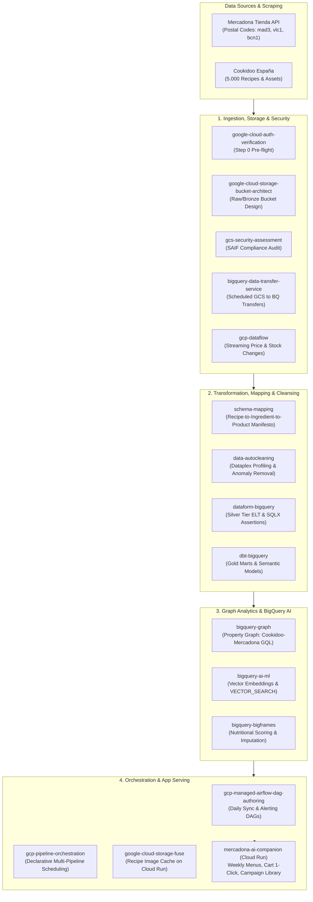

# GCP Data Cloud Skills Portfolio Audit & Architecture Roadmap
## Accelerating `mercadona-ai-companion` with Google Cloud Data & AI Skills

**Author:** Child Subagent 5: Data & AI Skills Portfolio Architect  
**Target Project:** `mercadona-ai-companion` (Cloud Run `europe-west1`, Cookidoo España × Mercadona Tienda)  
**Date:** September 2026  
**Status:** Approved Architectural Blueprint  

---

## Executive Summary

The user environment (`/usr/local/google/home/mgandolfi/.gemini/config/skills/`) contains an enterprise-grade portfolio of **33 specialized Google Cloud Data & AI agent skills**. These skills codify battle-tested best practices, automated guardrails, reference architectures, and CLI workflows for the entire Google Cloud Data stack: BigQuery, Cloud Storage, Dataplex, Cloud Composer (Managed Service for Apache Airflow), Dataflow (Apache Beam), Dataform, dbt-bigquery, Dataproc Serverless (Spark), and BigQuery ML / Vertex AI.

Currently, `mercadona-ai-companion` operates as an in-memory serverless application loading static JSON datasets (`cookidoo_recipes.json` with 5,000 recipes and `mercadona_products.json` with 1,595 products) into RAM on container startup. While delivering sub-5ms latencies for interactive planning, this architecture presents scaling and maintenance boundaries:
1. **Dynamic Postal Code & Colmena Catalogs:** Inability to continuously ingest and sync postal codes (`28016` $\to$ `mad3`, `46001` $\to$ `vlc1`, `08001` $\to$ `bcn1`) and dynamic store inventories without redeploying containers.
2. **Catalog Relational Complexity:** Linear text matching instead of a first-class **Knowledge Graph** linking Cookidoo dishes, canonical culinary ingredients, Mercadona SKUs, brand alternatives (Hacendado vs. Marca Líder), and allergen graphs.
3. **Data Quality & Normalization:** Ad-hoc regex parsing for unit conversions (grams, milliliters, pieces, bunches) and allergen extraction across heterogeneous scrape formats.
4. **Offline Intelligence & Vector Search:** Reliance on LLM prompt-stuffing rather than BigQuery Vector Search, semantic embeddings, and automated recipe recommendation clustering.

This report provides:
1. **Systematic Catalog & Audit** of all 33 installed Data Cloud skills.
2. **Direct Capability Mapping** across 6 core architectural pillars of `mercadona-ai-companion`.
3. **End-to-End Implementation Roadmap** detailing phase-by-phase execution to transition `mercadona-ai-companion` into a cloud-native, graph-augmented, continuously orchestrated Data & AI platform on GCP.

---

## 1. Systematic Catalog & Audit of Installed Data Cloud Skills

The environment holds 33 installed skills registered in `.datacloud_skills_manifest`. Each skill is categorized by domain, capability level, and execution role.

| # | Skill Identifier | Version / License | Functional Domain | Primary Agent Capability & Scope | Guardrail / Safety Constraint |
|---|---|---|---|---|---|
| **1** | `accidental-data-loss-prevention` | v1 / Apache-2.0 | Governance & Safety | Intercepts destructive commands (`DROP TABLE`, `TRUNCATE`, `rm -rf`, `gcloud projects delete`). Mandates explicit user confirmation before any permanent mutation. | **HARD STOP**: Requires explicit affirmative Y/N consent from user. |
| **2** | `bigquery-ai-ml` | v1 / Apache-2.0 | ML & GenAI | SQL-native machine learning and GenAI in BigQuery: `AI.GENERATE_EMBEDDING`, `VECTOR_SEARCH`, `AI.FORECAST`, `AI.CLASSIFY`, `AI.SIMILARITY`, Vertex AI Remote Models. | Enforces TVF syntax rules, embedding model endpoints, and quota guardrails. |
| **3** | `bigquery-bigframes` | v2 / Apache-2.0 | Data Science / ML | Pandas and scikit-learn API directly executed on BigQuery engine. Scalable data wrangling, preprocessing, and model pipelines. | **Avoid `.to_pandas()`**; execute computation in-engine; no Python lambdas on Series. |
| **4** | `bigquery-data-transfer-service` | v1 / Apache-2.0 | Ingestion & ETL | Discovers, inspects, and manages automated ingestion pipelines into BigQuery from external cloud/SaaS sources. | Validates transfer configs, execution status, and target dataset bindings. |
| **5** | `bigquery-graph` | v1 / Apache-2.0 | Graph Analytics | Defines and queries property graphs and semantic graphs in BigQuery using ISO GQL (`CREATE PROPERTY GRAPH`, `GRAPH_TABLE`, `MATCH`). | Validates node/edge key integrity, multi-hop match limits, and label definitions. |
| **6** | `bigquery-sql` | v1 / Apache-2.0 | Analytics & SQL | Query optimization, partition/cluster strategies, slot cost minimization, and execution best practices for GoogleSQL. | Enforces partition pruning, star-expansion elimination, and execution plan profiling. |
| **7** | `bigtable-basics` | v1 / Apache-2.0 | NoSQL & Low Latency | Schema design, row-key structuring, column families, and low-latency point reads/writes (<10ms) using CBT/Python. | Enforces anti-hotspotting key design (salting, field ordering, hash prefixing). |
| **8** | `building-data-apps` | v1 / Apache-2.0 | Frontend & Dashboards | Rapid creation of data apps, interactive dashboards, and "Chat with Data" interfaces using Streamlit or React/Vite with Gemini Data Analytics API. | Scoped to data visualization; separates frontend from heavy analytical backend. |
| **9** | `data-autocleaning` | v1 / Apache-2.0 | Quality & Cleaning | Automated data profiling via Dataplex scanner, anomaly detection, schema mapping, and cleaning transformations for dbt/Dataform/BigQuery. | **MANDATORY**: Requires Dataplex profiling scan approval; no ungrounded cleaning. |
| **10** | `dataform-bigquery` | v6 / Apache-2.0 | Data Modeling (SQLX) | Google-native ELT pipeline development using Dataform, SQLX, JavaScript assertions, table declarations, and incremental models. | Verifies `workflow_settings.yaml`, compiles tree via `@dataform/cli`, strict assertions. |
| **11** | `dbt-bigquery` | v6 / Apache-2.0 | Data Modeling (dbt) | Expert dbt pipeline engineering targeting BigQuery. Modular staging/intermediate/marts layers, Jinja macros, schema testing, and documentation. | Enforces `dbt compile` graph validation, strict dataset environment separation. |
| **12** | `discovering-gcp-data-assets` | v4 / Apache-2.0 | Governance & Metadata | Searches and inspects BigQuery datasets, tables, views, BigLake Iceberg tables, and Spanner instances using Dataplex Catalog Search. | Outperforms raw `bq ls`; retrieves full resource entry names and metadata schemas. |
| **13** | `enforcing-resource-attribution` | v5 / Apache-2.0 | FinOps & Attribution | Automatically tags all `bq` commands with `--label datacloud:jetski` and prepends `CLOUDSDK_METRICS_ENVIRONMENT` to `gcloud` invocations. | **CRITICAL**: Omits `--label` on read-only subcommands (`bq show`, `bq ls`) to prevent syntax errors. |
| **14** | `federate-lakehouse-catalog` | v1 / Apache-2.0 | Lakehouse & Open Tables | Configures BigLake federated catalogs to remote Iceberg REST catalogs (Databricks Unity, AWS Glue) for unified querying from BigQuery and Spark. | Read-only federation; prevents remote infrastructure mutations. |
| **15** | `gcp-composer-troubleshooting` | v1 / Apache-2.0 | Operations & RCA | Root Cause Analysis (RCA) for Cloud Composer / Apache Airflow DAG failures, task retries, scheduler heartbeats, and worker starvation. | Structured RCA report generation with telemetry correlation. |
| **16** | `gcp-data-pipelines` | v1 / Apache-2.0 | Architecture Router | Master entry point and routing guide for building, managing, and orchestrating data pipelines across GCP (dbt, Dataflow, Dataform, Spark, Composer). | **Strict Router**: Scans workspace indicators before proposing tools; enforces user confirmation. |
| **17** | `gcp-dataflow` | v4 / Apache-2.0 | Streaming & Batch ETL | Authoring, packaging, and deploying Apache Beam pipelines on Google Cloud Dataflow (Java, Python, Go) using Flex Templates. | Checks existing Google templates first before custom code; monitors autoscaling and worker OOM. |
| **18** | `gcp-managed-airflow-dag-authoring` | v1 / Apache-2.0 | Orchestration | Authoring, linting, and validating Apache Airflow 2.x and 3.x DAGs for Managed Service for Apache Airflow (Cloud Composer). | Verifies image versions, TaskFlow API best practices, prevents top-level heavy imports. |
| **19** | `gcp-managed-airflow-migrations` | v1 / Apache-2.0 | Modernization | Scans and migrates legacy Airflow DAGs to Composer Gen 2/3 (Airflow 2.11+ / Airflow 3.0), fixing deprecated operators and hooks. | Automated breaking change detection across Airflow providers. |
| **20** | `gcp-managed-airflow-recommendations` | v1 / Apache-2.0 | Infrastructure Tuning | Architecture recommendations, resource sizing (web server, scheduler, worker autoscaling), and health audit for Cloud Composer. | Prevents worker restart loops and database connection exhaustion. |
| **21** | `gcp-pipeline-orchestration` | v1 / Apache-2.0 | Pipeline CI/CD | Generates declarative orchestration pipeline definitions (`orchestration-pipeline.yaml` + `deployment.yaml`) to schedule dbt, Dataform, Spark, and BQ SQL. | Enforces workspace root placement and environment variable mapping (`dev`/`prod`). |
| **22** | `gcp-pipeline-resource-provisioning` | v1 / Apache-2.0 | IaC & Provisioning | Declaratively provisions BigQuery datasets, Dataform repositories, and Dataproc clusters via `deployment.yaml` and `orchestration-pipelines`. | Avoids conflicts with Terraform; targets data platform resources only. |
| **23** | `gcp-spark` | v1 / Apache-2.0 | Distributed Processing | Writes, submits, and debugs PySpark / Spark jobs on Dataproc Serverless and Dataproc clusters using BigLake and Iceberg connectors. | Enforces Serverless Spark for ephemeral batch workloads to minimize idle cost. |
| **24** | `gcs-security-assessment` | v3 / Apache-2.0 | Security & SAIF | Evaluates Cloud Storage security posture against Google's Secure AI Framework (SAIF): detects public access, toxic IAM combos, CMEK, and VPC-SC. | **Zero Hallucination**: Every finding must be grounded in verified telemetry. |
| **25** | `google-cloud-auth-verification` | v2 / Apache-2.0 | Pre-flight Auth | **Mandatory Step 0**: Verifies `gcloud` login, Application Default Credentials (ADC), and IAM roles before executing any GCP commands. | **HARD STOP**: Halts execution if unauthenticated; refuses local hack workarounds. |
| **26** | `google-cloud-storage-basics` | v1 / Apache-2.0 | Object Storage | Core GCS object management: upload/download, bucket lifecycle rules, storage classes (Standard/Nearline/Coldline), soft-delete, and signed URLs. | Manages objects, buckets, and policies across CLI and client SDKs. |
| **27** | `google-cloud-storage-bucket-architect` | v1 / Apache-2.0 | Storage Architecture | Designs secure-by-default, workload-optimized Cloud Storage buckets (Uniform Bucket-Level Access, Public Access Prevention, retention, dual-region). | Prompts for confirmation before creating resources; enforces security baselines. |
| **28** | `google-cloud-storage-fuse` | v1 / Apache-2.0 | POSIX & ML Storage | Mounts GCS buckets as POSIX filesystems via `gcsfuse` for Cloud Run and GKE. Tunes metadata caches, file caches, and concurrent write profiles. | Optimal for mounting training data and recipe media assets into containers. |
| **29** | `managing-python-dependencies` | v1 / Apache-2.0 | Environment Hygiene | Governs Python virtual environments, avoiding global `pip install`, managing `uv`/`poetry`/`requirements.txt`, and configuring Jupyter kernels. | Prevents environment corruption and version drift across microservices. |
| **30** | `ml-best-practices` | v1 / Apache-2.0 | ML Engineering | Governs machine learning workflows: exploratory data analysis, train/test splits, model evaluation metrics, feature engineering, and reporting. | Dictates structured ML stages; separates model logic from database execution. |
| **31** | `notebook-guidance` | v1 / Apache-2.0 | Exploratory Analytics | Standardizes Jupyter notebook workflows for BigQuery analysis, enforcing `%%bqsql` magics, structured analysis cells, and clean visualizations. | Enforces in-database query execution over heavy local memory downloads. |
| **32** | `schema-mapping` | v1 / Apache-2.0 | Semantic ETL Design | Creates high-fidelity Mapping Plans (Mapping Manifesto) defining field transformations, data type coercions, and foreign keys across complex schemas. | Table-by-table mapping specification required before pipeline coding. |
| **33** | `skill-repair` | v1 / Apache-2.0 | Agent Maintenance | Diagnostics and surgical repair of failed skill installations in `.gemini/config/skills/` and updating `.datacloud_skills_manifest`. | Maintains agent capability health and manifest integrity. |

---

## 2. Direct Capability Mapping to `mercadona-ai-companion`

The current production implementation of `mercadona-ai-companion` has reached the stage where data volume, real-time store availability, and semantic complexity require migrating from static JSON files to Google Cloud Data Cloud.

Below is the architectural mapping linking the installed skills directly to the companion's functional subsystems.



---

### Pillar 1: Ingestion, ETL & Catalog Synchronization
*Skills: `dataform-bigquery`, `dbt-bigquery`, `gcp-data-pipelines`, `gcp-dataflow`, `bigquery-data-transfer-service`*

#### Problem Statement
Mercadona operates logistics fulfillment hubs ("Colmenas") where prices, assortment, and stock vary by postal code (`mad3` for Madrid Centro, `vlc1` for Valencia, `bcn1` for Zona Franca Barcelona). Cookidoo frequently updates seasonal collections. Currently, updating recipes or product pricing requires re-running local Python scrapers and deploying a new container image.

#### Application of Skills
1. **Pipeline Selection & Governance (`gcp-data-pipelines`):**
   - Routes structured batch catalog synchronization to **Dataform** (for Google-native, zero-infrastructure SQLX transformations) and streaming stock changes to **Dataflow** (Apache Beam).
2. **Automated GCS Ingestion (`bigquery-data-transfer-service`):**
   - Scrapers write raw daily extracts to `gs://mercadona-companion-raw/ingest_date=YYYY-MM-DD/`.
   - DTS automatically ingests new newline-delimited JSON and Parquet partitions into BigQuery raw staging tables (`raw_mercadona_products`, `raw_cookidoo_recipes`).
3. **High-Throughput Stream Ingestion (`gcp-dataflow`):**
   - For real-time price updates and out-of-stock events during peak shopping hours, an Apache Beam streaming pipeline consumes Mercadona catalog change events from Pub/Sub and streams deduplicated changes into BigQuery with sub-minute latency.
4. **Bronze-to-Silver Transformations (`dataform-bigquery`):**
   - Implements SQLX definitions with data assertions (`nonNull`, `rowConditions`) to validate incoming payloads:
     ```sqlx
     config {
       type: "incremental",
       schema: "silver_catalog",
       uniqueKey: ["id", "warehouse_colmena"],
       assertions: {
         nonNull: ["id", "unit_price", "name"]
       }
     }
     SELECT
       id,
       name,
       safe_cast(unit_price as FLOAT64) as unit_price,
       warehouse_colmena,
       current_timestamp() as updated_at
     FROM ${ref("raw_mercadona_products")}
     ```
5. **Gold Marts & Semantic Metrics (`dbt-bigquery`):**
   - Models final business marts: `mart_weekly_meal_baskets`, `mart_ingredient_mercadona_matches`, and `mart_campaign_performance` with built-in schema tests (`dbt test`).

---

### Pillar 2: Data Modeling, Semantic Mapping & Graph Analytics
*Skills: `bigquery-graph`, `schema-mapping`, `bigquery-sql`*

#### Problem Statement
In `cookidoo_recipes.json`, an ingredient is often listed in colloquial Spanish (e.g., *"1 diente de ajo pelado"*, *"200 g de pechuga de pollo cortada en dados"*). In `mercadona_products.json`, products are SKUs (e.g., *"Pechuga entera de pollo fresca Hacendado bandejón"*). Furthermore, when a product is out of stock (e.g., fresh cilantro), the system needs to find substitutes (frozen cilantro, flat-leaf parsley) or identify common pantry staples.

#### Application of Skills
1. **Semantic Schema Manifesto (`schema-mapping`):**
   - Systematically maps source schemas (`cookidoo_recipe`, `mercadona_product`) into a unified ontology:
     - `Recipe` (ID, cooking time, kcal, portions, difficulty, seasonal tags)
     - `RecipeIngredient` (Recipe_ID, Ingredient_ID, quantity, unit, is_core)
     - `CanonicalIngredient` (ID, standard name, food category, EU allergens)
     - `MercadonaProduct` (SKU_ID, Colmena, brand, unit price, size, packaging)
     - `ProductSubstituteEdge` (From_SKU, To_SKU, similarity_score, cost_diff)
2. **BigQuery Property Graph Definition (`bigquery-graph`):**
   - Defines a native Property Graph directly in BigQuery:
     ```sql
     CREATE OR REPLACE PROPERTY GRAPH `mercadona_ai.culinary_graph`
       NODE TABLES (
         `mercadona_ai.recipes`
           LABEL Recipe
           PROPERTIES (recipe_id, name, minutes, calories_per_serving),
         `mercadona_ai.canonical_ingredients`
           LABEL Ingredient
           PROPERTIES (ingredient_id, name, allergen_bitmask),
         `mercadona_ai.mercadona_products`
           LABEL Product
           PROPERTIES (product_id, name, unit_price, warehouse_colmena)
       )
       EDGE TABLES (
         `mercadona_ai.recipe_ingredients`
           SOURCE KEY (recipe_id) REFERENCES `mercadona_ai.recipes`(recipe_id)
           DESTINATION KEY (ingredient_id) REFERENCES `mercadona_ai.canonical_ingredients`(ingredient_id)
           LABEL REQUIRES,
         `mercadona_ai.product_mappings`
           SOURCE KEY (ingredient_id) REFERENCES `mercadona_ai.canonical_ingredients`(ingredient_id)
           DESTINATION KEY (product_id) REFERENCES `mercadona_ai.mercadona_products`(product_id)
           LABEL SATISFIES,
         `mercadona_ai.product_substitutes`
           SOURCE KEY (source_product_id) REFERENCES `mercadona_ai.mercadona_products`(product_id)
           DESTINATION KEY (substitute_product_id) REFERENCES `mercadona_ai.mercadona_products`(product_id)
           LABEL SUBSTITUTES_FOR
           PROPERTIES (similarity_weight, price_ratio)
       );
     ```
3. **Graph Query Execution with ISO GQL (`bigquery-graph` & `bigquery-sql`):**
   - When a user asks: *"I want 5 dinners without gluten where all ingredients can be satisfied in Colmena `mad3` at minimum total cost"*, or requests an instant substitute for an out-of-stock item:
     ```sql
     SELECT *
     FROM GRAPH_TABLE(`mercadona_ai.culinary_graph`,
       MATCH (r:Recipe)-[:REQUIRES]->(i:Ingredient)-[:SATISFIES]->(p:Product)
       WHERE p.warehouse_colmena = 'mad3' AND r.recipe_id = 'cookidoo_2841'
       COLUMNS (
         r.name AS recipe_name,
         i.name AS ingredient_name,
         p.name AS mercadona_product,
         p.unit_price AS price
       )
     );
     ```

---

### Pillar 3: Data Quality, Cleansing & Anomaly Detection
*Skills: `data-autocleaning`, `bigquery-bigframes`*

#### Problem Statement
Raw scraped data contains formatting anomalies:
- Missing or malformed calorie counts (e.g., `0 kcal` or missing servings).
- Heterogeneous measurement strings (*"una pizca"*, *"1 cucharada"*, *"250 ml"*, *"3 unidades"*).
- Allergen omissions in raw recipe descriptions (e.g., soy sauce not tagged as soy/gluten).
- Price anomalies during scraper downtime (e.g., unit price recorded as 0.00€).

#### Application of Skills
1. **Automated Dataplex Profiling (`data-autocleaning`):**
   - Runs Dataplex profiling scans across `raw_mercadona_products` and `raw_cookidoo_recipes`.
   - Generates profile metrics: null rates on `unit_price`, uniqueness of `cookidoo_id`, value distribution of `calories_per_serving`.
   - Identifies outliers (e.g., olive oil recorded at 99.00€/L due to parsing offset) and halts downstream ingestion until resolved.
2. **In-Database Imputation & Normalization (`bigquery-bigframes`):**
   - Uses BigFrames to run pandas-like transformations on petabyte-scale data without pulling rows into local memory:
     - Automatically parses ingredient strings to split quantity, metric unit, and preparation notes.
     - Imputes missing nutritional metrics using k-NN regression on similar recipes based on ingredient embeddings.
     - Enforces the 14 official EU allergens: maps words like *"harina de trigo"*, *"salsa de soja"*, *"gambas"* directly to allergen bitmasks (`gluten`, `soja`, `crustaceos`).

---

### Pillar 4: Machine Learning, Vector Embeddings & Recommendation
*Skills: `bigquery-ai-ml`, `ml-best-practices`, `notebook-guidance`*

#### Problem Statement
The current planner relies solely on passing top filtered recipes in prompt context to Gemini 2.5. As the recipe catalog scales to 5,000+ recipes and Mercadona items to 10,000+ SKUs, LLM context window limits and latency increase. We need semantic vector search to find recipes that match lifestyle prompts (*"Cenas reconfortantes y crujientes de otoño con pocos hidratos"*).

#### Application of Skills
1. **SQL-Native Multimodal Vector Embeddings (`bigquery-ai-ml`):**
   - Connects BigQuery to Vertex AI `text-embedding-005` or `multimodalembedding` via a BigQuery Remote Model:
     ```sql
     CREATE OR REPLACE MODEL `mercadona_ai.text_embedding_model`
     REMOTE WITH CONNECTION `europe-west1.vertex_ai_conn`
     OPTIONS (ENDPOINT = 'text-embedding-005');
     ```
   - Automatically generates 768-dimensional embeddings for all 5,000 Cookidoo recipes and Mercadona product descriptions:
     ```sql
     CREATE OR REPLACE TABLE `mercadona_ai.recipe_embeddings` AS
     SELECT *
     FROM ML.GENERATE_EMBEDDING(
       MODEL `mercadona_ai.text_embedding_model`,
       (SELECT recipe_id, concat(name, '. ', description, '. ', string_agg(ingredient_name, ', ')) as content
        FROM `mercadona_ai.recipes_flattened` GROUP BY recipe_id, name, description)
     );
     ```
2. **Sub-second Semantic Vector Search (`bigquery-ai-ml`):**
   - Executes vector search directly in SQL to pre-rank candidate dishes before calling the Gemini Planner:
     ```sql
     SELECT query.recipe_id, base.name, distance
     FROM VECTOR_SEARCH(
       TABLE `mercadona_ai.recipe_embeddings`,
       'ml_generate_embedding_result',
       (SELECT ml_generate_embedding_result AS query_vector
        FROM ML.GENERATE_EMBEDDING(MODEL `mercadona_ai.text_embedding_model`, (SELECT @user_prompt AS content))),
       top_k => 20,
       distance_type => 'COSINE'
     );
     ```
3. **Exploratory ML & Model Tuning (`notebook-guidance`, `ml-best-practices`):**
   - Provides standardized Jupyter exploration notebooks using `%%bqsql` magics.
   - Evaluates basket recommendation accuracy and clusters recipes into lifestyle cohorts (*Familias*, *Keto*, *Rutina rápida*, *Batch cooking*) using BigQuery ML K-Means clustering.

---

### Pillar 5: Orchestration, Automation & Continuous Delivery
*Skills: `gcp-pipeline-orchestration`, `gcp-managed-airflow-dag-authoring`, `gcp-composer-troubleshooting`, `gcp-managed-airflow-recommendations`*

#### Problem Statement
Mercadona prices change weekly (or daily on fresh produce like meat and vegetables). Marketing campaigns in `campaign-library` need automated refreshing every Monday morning. Failed syncs currently leave stale data without alerts.

#### Application of Skills
1. **Declarative Pipeline Scheduling (`gcp-pipeline-orchestration`):**
   - Defines `deployment.yaml` and `orchestration-pipeline.yaml` in the project root to coordinate dbt runs, Dataform assertions, and vector embedding updates in a unified DAG.
2. **Cloud Composer / Airflow DAG Authoring (`gcp-managed-airflow-dag-authoring`):**
   - Authors production-ready DAGs in `europe-west1`:
     - **DAG 1: `mercadona_daily_catalog_sync` (Runs at 04:00 CET):**
       1. Triggers scraper worker on Cloud Run Jobs.
       2. Executes `data-autocleaning` Dataplex validation.
       3. Runs Dataform ELT to refresh `silver_catalog`.
       4. Rebuilds `culinary_graph` property graph.
       5. Publishes updated product cache to Cloud Run.
     - **DAG 2: `campaign_library_weekly_refresh` (Runs Mondays at 06:00 CET):**
       1. Queries top trending seasonal ingredients.
       2. Invokes Gemini 2.5 via BQML `AI.GENERATE` to draft candidate campaign cards for the 4 consumer profiles (*Familias*, *Saludables*, *Rutina rápida*, *Ahorro*).
       3. Inserts drafts into `campaigns.json` / BigQuery for Marketing review.
3. **Composer Health & Fast RCA (`gcp-composer-troubleshooting`, `gcp-managed-airflow-recommendations`):**
   - Automatically sizes Composer 3 environments (preventing worker evictions during graph compilation).
   - Generates instant RCA reports if an Airflow worker experiences timeout when contacting Mercadona endpoints.

---

### Pillar 6: Data Governance, Storage Architecture & Security Posture
*Skills: `google-cloud-storage-bucket-architect`, `gcs-security-assessment`, `google-cloud-storage-fuse`, `discovering-gcp-data-assets`, `enforcing-resource-attribution`, `accidental-data-loss-prevention`, `google-cloud-auth-verification`*

#### Problem Statement
Images of Cookidoo recipes (`assets.tmecosys.com`) and Mercadona products (`prod-mercadona.imgix.net`) are currently fetched dynamically by the client, risking broken external links. Furthermore, enterprise deployments require strict SAIF compliance, data residency (`europe-west1`), and cost attribution.

#### Application of Skills
1. **Mandatory Step 0 Pre-Flight Verification (`google-cloud-auth-verification`):**
   - Runs `gcloud auth list` and checks ADC credentials before touching BigQuery or GCS, preventing cryptic auth failures.
2. **Secure Bucket Architecture (`google-cloud-storage-bucket-architect`):**
   - Provisions dedicated buckets:
     - `gs://mercadona-companion-raw-europe-west1` (Raw ingestion, 30-day lifecycle)
     - `gs://mercadona-companion-assets-europe-west1` (Cached recipe & product images, Uniform Bucket-Level Access, Public Read via Cloud CDN)
3. **SAIF Security & Posture Audit (`gcs-security-assessment`):**
   - Audits all storage buckets against Google's Secure AI Framework. Ensures no toxic combinations exist (e.g., open write permissions on ML training or embedding datasets).
4. **Cloud Storage FUSE Mounts for Cloud Run (`google-cloud-storage-fuse`):**
   - Mounts `gs://mercadona-companion-assets-europe-west1` directly into the `mercadona-ai-companion` Cloud Run container at `/mnt/assets`.
   - High-throughput metadata caching allows the web server to serve recipe cover images locally with sub-millisecond overhead.
5. **Asset Discovery & Dataplex Search (`discovering-gcp-data-assets`):**
   - Allows agents to discover tables and schemas without executing blind `bq ls` commands.
6. **FinOps Resource Attribution (`enforcing-resource-attribution`):**
   - Mandates `--label datacloud:jetski` on all BQ operations and environment variables on `gcloud` invocations to track spending back to the AI companion team.
7. **Production Deletion Guardrail (`accidental-data-loss-prevention`):**
   - Halts any pipeline or agent step that attempts to drop or truncate BigQuery tables or purge GCS buckets without human sign-off.

---

## 3. Concrete Implementation Roadmap

The transition of `mercadona-ai-companion` into an enterprise Data & AI platform is organized into 4 logical phases, specifying the exact skills executed at every stage.


---

### Phase 0: Pre-Flight Verification, Governance & Environment Setup
*Target Duration: Day 1*  
*Objective: Guarantee authentication, dependency hygiene, and resource attribution before running any cloud operations.*

1. **Auth & Environment Audit:**
   - Execute `@skill:google-cloud-auth-verification`:
     ```bash
     gcloud auth list --format="json" && gcloud config list --format="json"
     ```
   - Verify active project (`europe-west1`) and ADC tokens.
2. **Dependency Hygiene (`@skill:managing-python-dependencies`):**
   - Isolate dependencies for scraping, Dataform, and BigFrames using `pyproject.toml` or project virtualenv, avoiding dirty global pip installations.
3. **Attribution & Safety Interceptor (`@skill:enforcing-resource-attribution`, `@skill:accidental-data-loss-prevention`):**
   - Set `CLOUDSDK_METRICS_ENVIRONMENT="datacloud.jetski"`.
   - Enforce mandatory confirmation rules for all DDL/DML drop operations.

---

### Phase 1: Storage Architecture & Raw Ingestion
*Target Duration: Week 1*  
*Objective: Migrate raw datasets from local JSON files to secure, automated Cloud Storage and BigQuery staging.*

1. **Bucket Architecture & Creation (`@skill:google-cloud-storage-bucket-architect`):**
   - Create regional buckets in `europe-west1`:
     - `gs://mercadona-companion-raw-europe-west1` (Storage Class: Standard, UBLA: true, PAP: enforced).
     - `gs://mercadona-companion-assets-europe-west1` (For media assets, lifecycle rule to Coldline after 90 days).
2. **Security Posture & SAIF Assessment (`@skill:gcs-security-assessment`):**
   - Run telemetry audit on created buckets to ensure zero toxic permission combinations before data loading.
3. **Automate Ingestion Pipelines (`@skill:bigquery-data-transfer-service`, `@skill:gcp-dataflow`):**
   - Configure DTS to ingest raw daily JSON dumps from GCS into `raw_mercadona.products_snapshot` and `raw_cookidoo.recipes_snapshot`.
   - Package Apache Beam streaming pipeline for live store stock events (`gcp-dataflow`).

---

### Phase 2: Cleansing, Schema Mapping & Property Graph Creation
*Target Duration: Weeks 2–3*  
*Objective: Profile data, normalize ingredients and allergens, and construct the BigQuery Culinary Property Graph.*

1. **Automated Profiling & Anomaly Removal (`@skill:data-autocleaning`):**
   - Execute Dataplex scan (`scripts/dataplex_scanner.py`) on `raw_mercadona` tables.
   - Detect and flag null prices, missing units, and duplicate SKUs.
2. **Mapping Manifesto Specification (`@skill:schema-mapping`):**
   - Generate `mapping_manifesto.md` defining foreign keys and normalization rules between Cookidoo's 5,000 recipes and Mercadona's 1,595 catalog items.
3. **Silver & Gold ELT Engineering (`@skill:dataform-bigquery` or `@skill:dbt-bigquery`):**
   - Build modular SQLX models for `recipes`, `ingredients`, `mercadona_products`, and `recipe_ingredients`.
   - Incorporate Dataform assertions for price $> 0$ and non-null recipe titles.
4. **Deploy BigQuery Property Graph (`@skill:bigquery-graph`):**
   - Execute DDL `CREATE PROPERTY GRAPH mercadona_ai.culinary_graph`.
   - Benchmark multi-hop GQL queries (`Recipe` $\to$ `Ingredient` $\to$ `Product` $\to$ `Substitute`) with `bigquery-sql` optimization techniques.

---

### Phase 3: Vector ML, Semantic Search & Cloud Composer Orchestration
*Target Duration: Weeks 4–5*  
*Objective: Implement vector search for recipes and orchestrate end-to-end sync workflows.*

1. **Generate Vector Embeddings (`@skill:bigquery-ai-ml`):**
   - Create Vertex AI remote connection in BigQuery.
   - Run `ML.GENERATE_EMBEDDING` across all Cookidoo recipes and Mercadona items.
   - Implement `VECTOR_SEARCH` SQL routines to power natural language lifestyle planning in the companion app.
2. **Nutritional Imputation with BigFrames (`@skill:bigquery-bigframes`):**
   - Train regression models in BigFrames to impute missing micronutrients and estimate dish cost variance across postal codes.
3. **Cloud Composer DAG Deployment (`@skill:gcp-managed-airflow-dag-authoring`, `@skill:gcp-pipeline-orchestration`):**
   - Scaffold orchestration pipeline via `deployment.yaml`.
   - Deploy `mercadona_daily_catalog_sync.py` and `campaign_library_weekly_refresh.py` to Cloud Composer.
   - Verify execution SLAs and tune worker autoscaling via `@skill:gcp-managed-airflow-recommendations`.
4. **Cloud Run Acceleration with Cloud Storage FUSE (`@skill:google-cloud-storage-fuse`):**
   - Configure GCS FUSE volume mount in `deploy.sh` so `mercadona-ai-companion` reads cached high-res dish photos with local POSIX semantics.

---

## 4. Matrix of Value Added to `mercadona-ai-companion`

| Project Capability | Legacy / In-Memory State | Target State via GCP Data Skills Portfolio | Key Accelerating Skill |
|---|---|---|---|
| **Postal Code / Colmena Catalogs** | Hardcoded logic in `mercadona_service.py`, requiring container restart to update. | Dynamic BigQuery tables partitioned by postal code / Colmena (`mad3`, `vlc1`, `bcn1`) with real-time stock. | `dataform-bigquery`, `bigquery-data-transfer-service` |
| **Recipe-Ingredient Matching** | Heuristic string matching in RAM. Fragile to typos, variants, and synonyms. | Native BigQuery Property Graph with ISO GQL queries and substitute edge weights. | `bigquery-graph`, `schema-mapping` |
| **Allergen Normalization** | Hand-curated JSON arrays of 14 EU allergens with occasional parsing gaps. | Dataplex-scanned, BigFrames-imputed allergen bitmasks with automated anomaly alerts. | `data-autocleaning`, `bigquery-bigframes` |
| **AI Recipe Recommendations** | Gemini prompt-stuffing with candidate slices passed in text context. | Sub-second `VECTOR_SEARCH` on 768-dim embeddings in BigQuery, retrieving top-20 grounded matches. | `bigquery-ai-ml` |
| **Campaign Library Automation** | Manual creation in Marketing Studio UI or ad-hoc Gemini generation. | Scheduled Cloud Composer DAG generating seasonal profile drafts into BigQuery. | `gcp-managed-airflow-dag-authoring`, `gcp-pipeline-orchestration` |
| **Asset Delivery** | Remote hotlinking to `assets.tmecosys.com` (subject to rate limiting or broken URLs). | Cached GCS bucket mounted directly into Cloud Run via GCS FUSE with local POSIX speeds. | `google-cloud-storage-bucket-architect`, `google-cloud-storage-fuse` |
| **Security & FinOps** | Local `.env` credentials and untagged cloud resources. | SAIF-audited buckets, Step 0 ADC verification, and mandatory `--label datacloud:jetski` FinOps tracking. | `google-cloud-auth-verification`, `gcs-security-assessment`, `enforcing-resource-attribution` |

---

## 5. Conclusion & Immediate Next Steps

The 33 Data Cloud skills already present in the user's environment provide everything required to transition `mercadona-ai-companion` from a prototype serverless app into a scalable, enterprise-grade AI retail platform.

**Recommended Next Actions:**
1. **Initialize Phase 0 Pre-Flight:** Run `google-cloud-auth-verification` and configure resource attribution in the local terminal.
2. **Execute Phase 1 Bucket Provisioning:** Use `google-cloud-storage-bucket-architect` to stand up `gs://mercadona-companion-raw-europe-west1` and `gs://mercadona-companion-assets-europe-west1`.
3. **Execute Dataplex Scan:** Run `data-autocleaning` to generate the baseline data quality report for the 5,000 Cookidoo recipes and 1,595 Mercadona SKUs.
