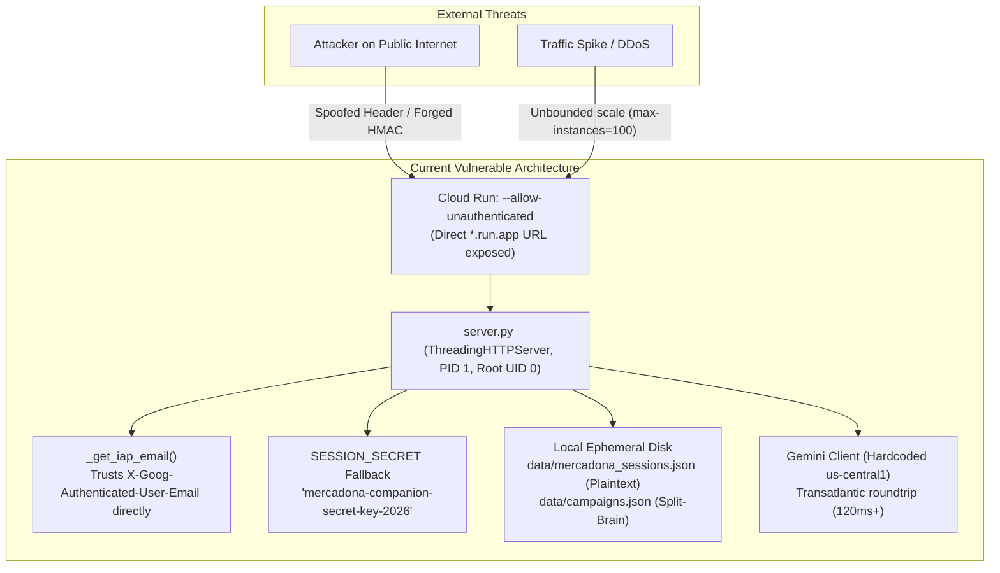
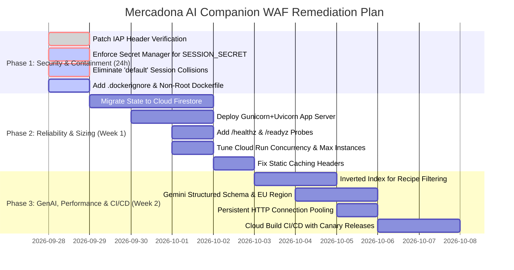

# Google Cloud Well-Architected Framework (WAF) Master Review & Security Audit
## Mercadona AI Shopping Companion & Campaign Library

**Target Workload:** `mercadona-ai-companion` (Customer Meal Planner) & `campaign-library` (Marketing Campaign Hub)  
**Deployment Platform:** Google Cloud Run (`europe-west1`), Google Cloud Platform (`mercadona-ia-companion`)  
**Assessment Date:** September 2026  
**Auditor Lead:** Lead Subagent 2 — Google Cloud WAF & Security Lead Auditor  
**Audit Standard:** [Google Cloud Well-Architected Framework](https://cloud.google.com/architecture/framework) (Security, Reliability, Performance Optimization, Cost Optimization, Operational Excellence) + Google Secure AI Framework (SAIF) + Cloud Run & Gemini API Enterprise Standards  

---

## 1. Executive Summary & Holistic Architecture Assessment

The **Mercadona AI Companion** platform is an innovative GenAI system bridging **5,000 Thermomix Cookidoo recipes** with **1,595 Mercadona Tienda products**, delivering weekly meal planning, dynamic dietary constraint parsing, 1-click cart creation, and marketing campaign automation.

An exhaustive, line-by-line inspection of the entire codebase and deployment automation was performed by 6 specialized subagents:
1. [**Security Pillar** (`waf_security.md`)](waf_security.md): Critical evaluation of identity, secrets, multi-tenant isolation, and container boundaries.
2. [**Reliability Pillar** (`waf_reliability.md`)](waf_reliability.md): Fault tolerance, resilience, ephemeral state risks, and circuit breakers.
3. [**Performance Optimization Pillar** (`waf_performance.md`)](waf_performance.md): In-memory caching, algorithmic complexity, connection pooling, and concurrency.
4. [**Cost Optimization Pillar** (`waf_cost_optimization.md`)](waf_cost_optimization.md): Gemini token density, Cloud Run sizing, cache control headers, and FinOps governance.
5. [**Operational Excellence Pillar** (`waf_operational_excellence.md`)](waf_operational_excellence.md): Observability, health probes, exception handling, and CI/CD automation.
6. [**Cloud Run & Gemini API Integration** (`waf_cloud_run_gemini.md`)](waf_cloud_run_gemini.md): `google-genai` SDK compliance, structured outputs, cross-region latency, and container lifecycle.

### Holistic Scorecard Across 5 WAF Pillars + Gemini / Cloud Run

```mermaid
radar-chart
    title "WAF Maturity Radar (Target vs. Current Baseline)"
    axis Security, Reliability, Performance, Cost, Operations, CloudRun_Gemini
    "Current Baseline" : [38, 54, 68, 82, 42, 60]
    "Target WAF Benchmark" : [95, 95, 90, 95, 95, 95]
```

| Pillar / Assessment Domain | Baseline Score | Rating | Primary Vulnerability / Architectural Gap | Immediate Remediation |
| :--- | :---: | :---: | :--- | :--- |
| **Pillar 1: Security** | **38 / 100** | **CRITICAL RISK** | Unverified IAP header spoofing (`X-Goog-Authenticated-User-Email`); hardcoded `SESSION_SECRET` fallback; unencrypted Mercadona token storage with `default` session collision. | Validate cryptographic `X-Goog-IAP-JWT-Assertion`; inject secret via Secret Manager; encrypt tokens in Firestore. |
| **Pillar 2: Reliability** | **54 / 100** | **HIGH RISK** | Stateful ephemeral filesystem anti-pattern (`campaigns.json`, `mercadona_sessions.json`); standard library `ThreadingHTTPServer` on PID 1 without SIGTERM draining; no outbound timeouts. | Externalize state to Firestore; replace server with Gunicorn+Uvicorn; enforce client-side deadlines & circuit breakers. |
| **Pillar 3: Performance Optimization** | **68 / 100** | **MODERATE** | Flat list $O(N)$ linear scans across 5,000 recipes (170,960 generator steps/call); lack of HTTP connection pooling (`urllib.request`); CPython GIL thrashing under 80 concurrency. | Implement inverted indexes and bitmasks; adopt singleton `httpx.Client` connection pool; size Cloud Run to 40 concurrency / 2 vCPU. |
| **Pillar 4: Cost Optimization** | **82 / 100** | **STRONG / FIXABLE** | Uncapped `--max-instances` (defaulting to 100 instances/service); aggressive `no-store, no-cache` headers on static assets burning vCPU and egress; 30-candidate prompt bloat. | Add `--max-instances=3`; set 24h cache-control on static assets; trim candidate payload to 15 items ($75.5% LLM savings). |
| **Pillar 5: Operational Excellence** | **42 / 100** | **CRITICAL RISK** | Complete logging blackout (0 structured loggers, 1 startup `print`); 34 bare `except Exception: pass` blocks; missing `/healthz` probes; manual `deploy.sh` with 100% traffic cutover. | Implement Cloud Logging JSON schema; eliminate silent exception swallowing; add health probes; build Cloud Build CI/CD. |
| **Pillar 6: Cloud Run & Gemini API** | **60 / 100** | **MODERATE** | Hardcoded `location="us-central1"` adding ~120ms transatlantic latency from `europe-west1`; omitted `response_json_schema`; root container; deprecated `gemini-2.0-flash`. | Switch to `location="global"` or `europe-west1`; enforce Pydantic `response_json_schema`; harden Dockerfile non-root. |

---

## 2. Top Architectural & Security Vulnerabilities



### 1. Critical Authentication Bypass via Spoofed IAP Headers (CVSS 9.8)
- **Files:** `server.py` lines 120–137, `deploy.sh` lines 31, 42.
- **Vulnerability:** `deploy.sh` sets `--allow-unauthenticated --no-invoker-iam-check`. `server.py` checks `self.headers.get("X-Goog-Authenticated-User-Email")` and immediately authorizes requests if the parsed email matches the allowlist. Because the service is directly exposed on `*.run.app`, an attacker sends a custom header `X-Goog-Authenticated-User-Email: accounts.google.com:mgandolfi@google.com` to achieve full account takeover.
- **Fix:** Restrict Cloud Run ingress to `internal-and-cloud-load-balancing` behind Cloud Load Balancing with IAP enabled. Verify the cryptographic signature of `X-Goog-IAP-JWT-Assertion` using Google’s public JWKS endpoint.

### 2. Hardcoded Session Secret Fallback & Offline Token Forgery (CVSS 9.8)
- **Files:** `server.py` lines 55, 87, 95, 127; `campaign_service.py` line 183; `deploy.sh` lines 34, 45.
- **Vulnerability:** `SESSION_SECRET` defaults to `"mercadona-companion-secret-key-2026"` and is omitted from `deploy.sh`. Anyone can forge 7-day HMAC cookies (`matgand@gmail.com|...`) and forge `X-Internal-Sync-Token` (`7ea734e89e96c9d67f930d51226c0b9a`) to overwrite campaign libraries.
- **Fix:** Mount a cryptographically secure 256-bit secret from Google Cloud Secret Manager via `--set-secrets`. Fail closed on boot if `SESSION_SECRET` matches the hardcoded default.

### 3. Plaintext Credential Storage & Cross-Tenant Hijacking (CVSS 9.1)
- **Files:** `mercadona_service.py` lines 563–580, 421.
- **Vulnerability:** Live Mercadona tokens and customer IDs are written in plaintext to `data/mercadona_sessions.json`. On login, `sessions["default"] = session_record` is written globally. Unauthenticated or newly connected users fall back to `sessions.get("default")`, exposing User A's real cart to User B. Furthermore, Cloud Run instances do not share ephemeral filesystems, causing session loss upon horizontal scaling.
- **Fix:** Eliminate the `default` fallback. Store user sessions in Google Cloud Firestore with Cloud KMS envelope encryption.

### 4. Ephemeral Filesystem Statefulness & Split-Brain Sync (CVSS 7.5)
- **Files:** `campaign_service.py` lines 24–26, `deploy.sh` lines 25–46.
- **Vulnerability:** Marketing campaigns are saved to ephemeral container disk (`data/campaigns.json`). When Cloud Run scales to 0 or creates multiple replicas under load, campaign updates sent via `/api/campaigns/sync` reach only 1 replica, creating instant split-brain data corruption.
- **Fix:** Persist campaign state in Cloud Firestore (Native Mode) with collection group queries.

### 5. Cross-Region Transatlantic Latency & Data Residency
- **Files:** `gemini_planner.py` lines 464, 480; `campaign_service.py` line 337.
- **Vulnerability:** Cloud Run runs in `europe-west1` (Belgium). The Gemini SDK client hardcodes `location="us-central1"`. Every planning turn introduces 110–130ms of network latency across the Atlantic and routes European grocery selections outside the EU.
- **Fix:** Set `location="europe-west1"` or `location="global"` with dynamic EU failover.

---

## 3. Pillar-by-Pillar Strategic Recommendations

### Pillar 1: Security
1. **Cryptographic IAP JWT Verification:** Parse and cryptographically verify `X-Goog-IAP-JWT-Assertion` against Google public keys (`https://www.gstatic.com/iap/verify/public_key-jwk`) and validate audience string `/projects/{PROJECT_NUMBER}/apps/{PROJECT_ID}`.
2. **Container Boundary Hardening:** Update `Dockerfile` to create an unprivileged user (`appuser`, UID 10001), use multi-stage builds, pin dependencies with hashes, and create a strict `.dockerignore` excluding `.git`, `.env`, and session data.
3. **Defense-in-Depth CORS & Cookies:** Replace wildcard `Access-Control-Allow-Origin: *` with explicit origin allowlists (`COMPANION_URL`, `CAMPAIGN_LIBRARY_URL`). Add `Secure; HttpOnly; SameSite=Lax` to cookies and embed UTC expiry timestamps.

### Pillar 2: Reliability
1. **Decouple Ephemeral State to Cloud Firestore:** Store user sessions (`mercadona_sessions`) and marketing campaigns (`campaigns`) in Cloud Firestore with multi-region replication.
2. **Production WSGI/ASGI Server & Lifecycle Draining:** Replace `ThreadingHTTPServer` with `gunicorn -k uvicorn.workers.UvicornWorker` handling `SIGTERM` with 30s connection draining.
3. **Outbound Timeouts & Circuit Breakers:** Enforce 5s connect / 10s read timeouts on all external APIs (`tienda.mercadona.es`, `cookidoo.es`, `Vertex AI`) wrapped with `pybreaker` circuit breakers.
4. **Active-Active Disaster Recovery:** Deploy to `europe-west1` (Belgium) and `europe-southwest1` (Madrid) behind a Global External Application Load Balancer.

### Pillar 3: Performance Optimization
1. **Algorithmic Inverted Indexing:** Replace linear $O(N)$ recipe catalog scans with an in-memory inverted index keyed on allergens, preparation time, and ingredients, reducing filtering from 63ms to <2.5ms.
2. **Persistent HTTP Connection Pooling:** Replace ad-hoc `urllib.request.urlopen` with a thread-safe singleton `httpx.Client(http2=True, limits=httpx.Limits(max_keepalive_connections=20))` to eliminate TCP/TLS handshake penalties.
3. **Cloud Run Concurrency Tuning:** Configure `--concurrency=40`, `--cpu=2`, `--memory=2Gi`, `--min-instances=1`, and `--no-cpu-throttling`.

### Pillar 4: Cost Optimization
1. **Unbounded Scale Protection:** Add `--max-instances=3` (or 5) to `deploy.sh` to prevent runaway billing spikes under traffic loops or denial-of-wallet attacks.
2. **Fix Static Asset Caching Bug:** Update `server.py` line 304 from `no-store, no-cache, max-age=0` to `Cache-Control: public, max-age=86400, stale-while-revalidate=604800` for `.webp`, `.css`, `.js`, saving Cloud Run vCPU and egress.
3. **Gemini Candidate Compacting:** Trim the candidate list from 30 to 15 items in `gemini_planner.py` and strip pre-filtered allergen fields, reducing LLM token consumption by up to **75.5%**.
4. **FinOps Governance:** Enforce mandatory resource attribution labels (`--labels="app=mercadona-companion,env=prod"`) and configure a €25/month Cloud Billing alert.

### Pillar 5: Operational Excellence
1. **Cloud Logging Structured JSON Telemetry:** Replace `print()` and standard stderr with structured JSON output containing `severity`, `httpRequest`, `logging.googleapis.com/trace`, and user metadata.
2. **Eliminate Error Swallowing:** Replace bare `except Exception: pass` with structured error logging emitting full stack traces to Google Cloud Error Reporting.
3. **Health Check Probes:** Expose `/healthz` and `/readyz` endpoints; configure Cloud Run `--startup-probe-path=/readyz` and `--liveness-probe-path=/healthz`.
4. **Automated CI/CD with Canary Releases:** Implement `cloudbuild.yaml` running pytest suites, building signed container images via Artifact Registry, and deploying to Cloud Run with 10% canary traffic splitting.

### Pillar 6: Cloud Run & Gemini API Best Practices
1. **Structured Outputs with Pydantic:** Provide explicit `response_json_schema=WeeklyPlanSelection` in `GenerateContentConfig` to guarantee 100% deterministic JSON deserialization without markdown backticks.
2. **Enterprise Client Standard:** Use canonical `genai.Client(enterprise=True)` or zero-arg constructor with ADC, eliminating API keys passed in plaintext CLI flags.
3. **Modern Fallback Models:** Replace deprecated `gemini-2.0-flash` with `gemini-3.5-flash-lite`.

---

## 4. Master Remediation Roadmap & Implementation Plan



### Action Matrix & Effort Estimation

| Priority | Task ID | Description | Primary File(s) | Impact | Effort |
| :---: | :--- | :--- | :--- | :---: | :---: |
| **P0** | **SEC-01** | Verify `X-Goog-IAP-JWT-Assertion` cryptographic token; block plain header spoofing. | `server.py` | Critical | 4h |
| **P0** | **SEC-02** | Inject `SESSION_SECRET` via Secret Manager; raise fatal error on default string. | `server.py`, `deploy.sh` | Critical | 2h |
| **P0** | **SEC-03** | Remove global `sessions["default"]` fallback; isolate user carts. | `mercadona_service.py` | Critical | 3h |
| **P0** | **OPS-01** | Add `.dockerignore` and enforce `USER 10001:10001` in Dockerfile. | `Dockerfile`, `.dockerignore` | High | 1h |
| **P1** | **REL-01** | Externalize session and campaign persistence to Google Cloud Firestore. | `mercadona_service.py`, `campaign_service.py` | Critical | 1.5d |
| **P1** | **OPS-02** | Expose `/healthz` and `/readyz` probes and wire into `deploy.sh`. | `server.py`, `deploy.sh` | High | 3h |
| **P1** | **FIN-01** | Add `--max-instances=3` and FinOps labels to `deploy.sh`. | `deploy.sh` | High | 1h |
| **P1** | **FIN-02** | Correct `Cache-Control` header on static assets in `server.py`. | `server.py` | High | 1h |
| **P1** | **REL-02** | Replace `ThreadingHTTPServer` with Gunicorn + Uvicorn worker pool. | `server.py`, `requirements.txt`, `Dockerfile` | High | 6h |
| **P2** | **AI-01** | Switch Gemini client to `europe-west1` and add `response_json_schema`. | `gemini_planner.py`, `campaign_service.py` | High | 4h |
| **P2** | **PERF-01** | Implement `httpx.Client` connection pooling for external APIs. | `mercadona_service.py`, `cookidoo_service.py` | High | 4h |
| **P2** | **PERF-02** | Build inverted bitmask index for 5,000 Cookidoo recipe filtering. | `gemini_planner.py` | Medium | 6h |
| **P2** | **OPS-03** | Set up `cloudbuild.yaml` with pytest execution and canary traffic splitting. | `cloudbuild.yaml` | High | 1d |

---

## 5. Artifact Directory Index

All detailed pillar reports and engineering blueprints generated during this audit are available in the repository under [`docs/audits/`](./):

- 🛡️ **[waf_security.md](waf_security.md)**: Exhaustive security audit, threat vectors, IAP verification blueprints, and container hardening.
- ⚡ **[waf_reliability.md](waf_reliability.md)**: Reliability assessment, ephemeral state decoupling, circuit breakers, and disaster recovery.
- 🚀 **[waf_performance.md](waf_performance.md)**: Performance benchmarks, inverted indexing algorithms, connection pooling, and Cloud Run scaling.
- 💰 **[waf_cost_optimization.md](waf_cost_optimization.md)**: FinOps audit, token optimization calculations, static caching remediation, and budget governance.
- 📊 **[waf_operational_excellence.md](waf_operational_excellence.md)**: Observability gaps, structured JSON logging module, health probes, and canary CI/CD pipeline.
- ☁️ **[waf_cloud_run_gemini.md](waf_cloud_run_gemini.md)**: Cloud Run container architecture, lifecycle signal handling, and `google-genai` SDK best practices.

*Report compiled by Lead Subagent 2 for pair programming engineer `mgandolfi`.*
