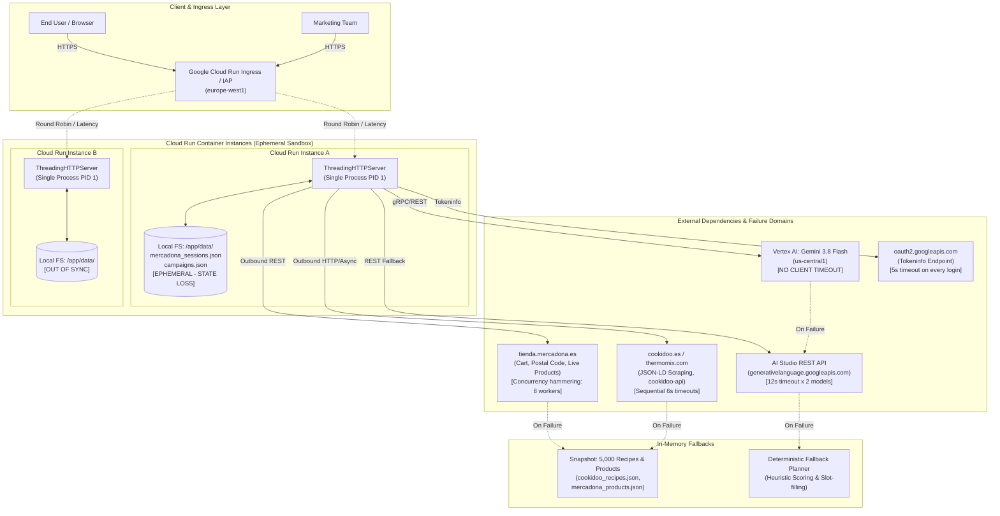

# Google Cloud Well-Architected Framework (WAF) Audit: Reliability Pillar
**Target Workload:** Mercadona AI Companion & Campaign Library Microservices  
**Repository:** `/usr/local/google/home/mgandolfi/mercadona-ai-companion`  
**Auditor:** Auditor 2 — Google Cloud WAF Reliability Pillar Lead  
**Assessment Standards:** Google Cloud Well-Architected Framework: Reliability Pillar ([`google-cloud-waf-reliability`](file:///google/src/files/head/depot/google3/third_party/skills/skills/cloud/google-cloud-waf-reliability/SKILL.md))  
**Date:** September 2026

---

## Executive Summary

The **Mercadona AI Companion** and **Campaign Library** are dual-purpose microservices deployed on **Google Cloud Run** (`mercadona-ai-companion` and `campaign-library` in region `europe-west1`), designed to bridge Vorwerk Thermomix Cookidoo guided cooking with real-time Mercadona e-commerce baskets via Google Gemini 3.8 Flash.

An exhaustive audit of the entire codebase ([`server.py`](file:///usr/local/google/home/mgandolfi/mercadona-ai-companion/server.py), [`gemini_planner.py`](file:///usr/local/google/home/mgandolfi/mercadona-ai-companion/gemini_planner.py), [`mercadona_service.py`](file:///usr/local/google/home/mgandolfi/mercadona-ai-companion/mercadona_service.py), [`cookidoo_service.py`](file:///usr/local/google/home/mgandolfi/mercadona-ai-companion/cookidoo_service.py), [`campaign_service.py`](file:///usr/local/google/home/mgandolfi/mercadona-ai-companion/campaign_service.py), [`Dockerfile`](file:///usr/local/google/home/mgandolfi/mercadona-ai-companion/Dockerfile), [`deploy.sh`](file:///usr/local/google/home/mgandolfi/mercadona-ai-companion/deploy.sh), and [`requirements.txt`](file:///usr/local/google/home/mgandolfi/mercadona-ai-companion/requirements.txt)) was conducted against the **Google Cloud Well-Architected Framework Reliability Pillar** core principles:
1. *Define reliability based on user-experience goals*
2. *Set realistic targets for reliability (SLIs/SLOs/Error Budgets)*
3. *Build highly available systems through resource redundancy*
4. *Take advantage of horizontal scalability*
5. *Detect potential failures by using observability*
6. *Design for graceful degradation*
7. *Perform testing for recovery from failures and data loss*
8. *Conduct thorough blameless postmortems*

### Overall Reliability Posture: **High Risk / Non-Production Ready (Score: 54/100)**

```
+------------------------------------------------------------------------------------------+
|                        WAF RELIABILITY SCORECARD SUMMARY                                 |
+------------------------------------+-------+---------------------------------------------+
| Dimension                          | Score | Status                                      |
+------------------------------------+-------+---------------------------------------------+
| 1. Graceful Degradation & Fallback | 85%   | Strong local snapshots & deterministic math |
| 2. Fault Tolerance & Deadlines     | 45%   | Missing client timeouts, bare exceptions    |
| 3. High Availability & Statelessness| 28%  | CRITICAL: Ephemeral JSON storage on Cloud Run|
| 4. Server Concurrency & Web Engine | 35%   | CRITICAL: ThreadingHTTPServer on PID 1      |
| 5. Multi-Region & Disaster Recovery| 30%   | Single-region europe-west1, RPO = Infinity  |
| 6. Observability & Health Probes   | 40%   | Missing HTTP startup/liveness health checks |
+------------------------------------+-------+---------------------------------------------+
```

While the workload demonstrates **outstanding domain-level fallback engineering** (such as deterministic 5,000-recipe catalog filtering and automatic heuristic campaign generation when LLMs fail), it suffers from **severe foundational infrastructure and distributed systems anti-patterns**:
- **Stateful Serverless Anti-pattern:** Dynamic customer sessions and marketing campaigns are stored in container-local files (`data/campaigns.json`, `data/mercadona_sessions.json`). On Cloud Run, multi-instance horizontal scaling causes immediate session bifurcation, scale-to-zero causes total data loss, and container redeployments wipe state permanently.
- **Unbounded Web Server:** The application executes Python's standard library `ThreadingHTTPServer` directly on port 8080 without a production WSGI/ASGI supervisor (Gunicorn/Uvicorn), leading to thread starvation and ungraceful termination during autoscaling down events.
- **Cascading Timeout Vulnerability:** External calls lack coordinated global deadlines, exponential backoff, jitter, and circuit breakers. Cascading Gemini fallback models can consume 30–60 seconds, triggering HTTP 504 Gateway Timeouts at Cloud Run ingress before deterministic fallbacks execute.

---

## Architecture Topology & Reliability Boundaries



---

## Detailed Audit Findings by Severity

```
+-------------------------------------------------------------------------------------------------------------------------+
|                                              AUDIT FINDINGS MATRIX                                                      |
+--------+----------------------------------------------------+----------+---------------------+--------------------------+
| ID     | Finding Title                                      | Severity | Pillar Area         | Primary Impact           |
+--------+----------------------------------------------------+----------+---------------------+--------------------------+
| REL-01 | Ephemeral File Persistence on Cloud Run            | CRITICAL | Data Persistence    | Total data loss / split  |
| REL-02 | Non-Production ThreadingHTTPServer on PID 1        | CRITICAL | Server Resilience   | Thread starvation / DoS  |
| REL-03 | Missing Vertex AI Client-Side Deadlines & Timeouts | CRITICAL | Fault Tolerance     | Process hang / HTTP 504  |
| REL-04 | Broken Multi-Instance Service Peer-to-Peer Sync    | HIGH     | High Availability   | Permanent desync         |
| REL-05 | Upstream Mercadona API Concurrency Hammering       | HIGH     | Rate Limiting       | IP ban / HTTP 429        |
| REL-06 | Total Absence of Exponential Backoff & Jitter      | HIGH     | Graceful Recovery   | Thundering herd          |
| REL-07 | Single-Region europe-west1 Deployment (No DR)      | HIGH     | Disaster Recovery   | Outage single point      |
| REL-08 | Unsynchronized Concurrency in Mercadona Service    | HIGH     | Thread Safety       | Session invalidation     |
| REL-09 | Cloud Run Configuration Deficits (Probes/Sizing)   | HIGH     | Operations/Scaling  | Zombie container routing |
| REL-10 | Pervasive Silent Bare Exception Masking            | MEDIUM   | Observability       | Blind operational triage |
| REL-11 | Silent 512KB Request Body Clamping Without 413     | MEDIUM   | API Robustness      | Corrupted HAR uploads    |
| REL-12 | Outbound Tokeninfo Latency on Every Auth Login     | MEDIUM   | Auth Resilience     | Upstream IDP bottleneck  |
+--------+----------------------------------------------------+----------+---------------------+--------------------------+
```

---

### CRITICAL SEVERITY FINDINGS

#### [REL-01] Ephemeral Local File Persistence Violates Cloud Run Statelessness
- **Impacted Code:**
  - [`mercadona_service.py:22-25`](file:///usr/local/google/home/mgandolfi/mercadona-ai-companion/mercadona_service.py#L22-L25), [`392-415`](file:///usr/local/google/home/mgandolfi/mercadona-ai-companion/mercadona_service.py#L392-L415): `SESSIONS_FILE = DATA_DIR / "mercadona_sessions.json"`
  - [`campaign_service.py:24-25`](file:///usr/local/google/home/mgandolfi/mercadona-ai-companion/campaign_service.py#L24-L25), [`160-178`](file:///usr/local/google/home/mgandolfi/mercadona-ai-companion/campaign_service.py#L160-L178): `CAMPAIGNS_FILE = DATA_DIR / "campaigns.json"`
- **Vulnerability & Mechanics:**
  1. **Split-Brain Session Loss:** Cloud Run autoscales horizontally from 0 to 100 instances. When User A authenticates on Instance 1, their Bearer JWT and refresh token are written to `/app/data/mercadona_sessions.json` on Instance 1's isolated container overlay filesystem. When User A subsequent clicks *"Añadir a mi cesta"*, Cloud Run routes the request to Instance 2. Instance 2's filesystem lacks this session, returning `"connected": false`.
  2. **Scale-to-Zero Annihilation:** During idle periods (default `--min-instances 0`), Cloud Run terminates all container instances. Dynamic campaigns created by Marketing and saved sessions are destroyed. When a new instance cold-starts, it boots from the initial Docker container image snapshot.
  3. **Revision Deployment Wipes:** Executing [`deploy.sh`](file:///usr/local/google/home/mgandolfi/mercadona-ai-companion/deploy.sh) builds and rolls out a new container revision, instantly abandoning all old container instances and destroying any runtime state.
- **WAF Reliability Violation:** Principle: *Design stateless services and decouple compute from persistent state*.

#### [REL-02] Use of Standard Library `ThreadingHTTPServer` as PID 1 Production Server
- **Impacted Code:**
  - [`server.py:23`](file:///usr/local/google/home/mgandolfi/mercadona-ai-companion/server.py#L23), [`542-547`](file:///usr/local/google/home/mgandolfi/mercadona-ai-companion/server.py#L542-L547): `server = ThreadingHTTPServer(("0.0.0.0", port), CompanionRequestHandler)`
  - [`Dockerfile:18`](file:///usr/local/google/home/mgandolfi/mercadona-ai-companion/Dockerfile#L18): `CMD ["python3", "server.py"]`
- **Vulnerability & Mechanics:**
  1. **Thread Starvation:** `ThreadingHTTPServer` inherits from `socketserver.ThreadingMixIn`. It spawns an unbound, non-pooled OS thread for every incoming TCP connection. Under sustained concurrent requests or Slowloris connections, thread creation consumes all system file descriptors and virtual memory (`pthread_create failed: Resource temporarily unavailable`).
  2. **Single Process Blast Radius:** Python runs as PID 1 without a process supervisor (such as Gunicorn or Uvicorn multi-worker process models). Any unhandled segfault, unhandled exception in background C-extensions, or thread panic terminates the entire container.
  3. **No Graceful Shutdown or Connection Draining:** On Cloud Run revision rollout or scale-down, Cloud Run sends `SIGTERM`. `ThreadingHTTPServer.serve_forever()` does not catch `SIGTERM` to allow in-flight Gemini generation (3–8s) or cart operations to finish; connections are immediately severed with `ECONNRESET`.
- **WAF Reliability Violation:** Principle: *Build resilience into server infrastructure and manage process lifecycles*.

#### [REL-03] Vertex AI GenAI SDK Calls Lack Client-Side Deadlines & Timeouts
- **Impacted Code:**
  - [`gemini_planner.py:467-475`](file:///usr/local/google/home/mgandolfi/mercadona-ai-companion/gemini_planner.py#L467-L475):
    ```python
    resp = client.models.generate_content(
        model=model_name,
        contents=user_payload,
        config=types.GenerateContentConfig(
            system_instruction=sys_instruction,
            temperature=0.2,
            response_mime_type="application/json",
        ),
    )
    ```
  - [`campaign_service.py:340-348`](file:///usr/local/google/home/mgandolfi/mercadona-ai-companion/campaign_service.py#L340-L348)
- **Vulnerability & Mechanics:**
  Neither call configures a client timeout in `types.GenerateContentConfig` or through `http_options`. If a regional network degradation or transit disruption occurs between `europe-west1` and `us-central1`, the synchronous gRPC/HTTP2 call blocks indefinitely. Because there is no client-side deadline, the worker thread hangs until Cloud Run ingress forcefully terminates the request after 300 seconds.
- **WAF Reliability Violation:** Principle: *Set timeouts and handle deadlines gracefully to prevent cascading failure*.

---

### HIGH SEVERITY FINDINGS

#### [REL-04] Broken Multi-Instance Service Peer-to-Peer Synchronization
- **Impacted Code:**
  - [`campaign_service.py:226-252`](file:///usr/local/google/home/mgandolfi/mercadona-ai-companion/campaign_service.py#L226-L252): `push_sync_to_peer_services()`
  - [`server.py:371-382`](file:///usr/local/google/home/mgandolfi/mercadona-ai-companion/server.py#L371-L382): `/api/campaigns/sync`
- **Vulnerability & Mechanics:**
  `push_sync_to_peer_services` executes an HTTP POST to `COMPANION_APP_URL/api/campaigns/sync`. In Google Cloud Run, this URL routes through Google's front-end load balancer to **one random active container instance**. If `mercadona-ai-companion` is scaled to 3 instances ($I_1, I_2, I_3$), only $I_1$ receives the sync payload. Instances $I_2$ and $I_3$ remain desynchronized. Peer-to-peer synchronization over an auto-routed serverless environment is an architectural anti-pattern.

#### [REL-05] Upstream Mercadona API Concurrency Hammering via ThreadPoolExecutor
- **Impacted Code:**
  - [`mercadona_service.py:170-178`](file:///usr/local/google/home/mgandolfi/mercadona-ai-companion/mercadona_service.py#L170-L178):
    ```python
    with concurrent.futures.ThreadPoolExecutor(max_workers=8) as ex:
        futures = {ex.submit(fetch_live_product, pid, wh): pid for pid in ids_to_check}
    ```
- **Vulnerability & Mechanics:**
  Every time a user plans a weekly menu or resolves a catalog, up to 25 separate live requests are fired across 8 concurrent threads against `https://tienda.mercadona.es/api/products/{pid}/`. Under concurrent user queries, dozens or hundreds of concurrent requests hit Mercadona's edge, triggering automated WAF / Akamai bot protection, IP rate limiting (HTTP 429), or TCP drops. Because errors return `None`, valid products are silently dropped from user menus.

#### [REL-06] Total Absence of Exponential Backoff, Jitter, and Circuit Breakers
- **Impacted Code:**
  - [`mercadona_service.py:499-528`](file:///usr/local/google/home/mgandolfi/mercadona-ai-companion/mercadona_service.py#L499-L528): Immediate retry in `range(2)` with zero sleep.
  - [`gemini_planner.py:465-525`](file:///usr/local/google/home/mgandolfi/mercadona-ai-companion/gemini_planner.py#L465-L525): Immediate model iteration.
- **Vulnerability & Mechanics:**
  Zero instances of exponential backoff (`t = base * 2^attempt`) or randomized jitter exist anywhere in the codebase. When upstream services experience transient 429 or 503 throttling, immediate consecutive retries exacerbate upstream distress (thundering herd). Furthermore, there is **no circuit breaker**. When Mercadona or Cookidoo is offline, every single user request blocks through the full chain of timeouts (up to 40 seconds) rather than tripping a circuit breaker and serving cached data immediately.

#### [REL-07] Single-Region Deployment (`europe-west1`) Lacks High Availability & Disaster Recovery
- **Impacted Code:**
  - [`deploy.sh:8-9`](file:///usr/local/google/home/mgandolfi/mercadona-ai-companion/deploy.sh#L8-L9): `REGION="${REGION:-europe-west1}"`
  - [`deploy.sh:25-46`](file:///usr/local/google/home/mgandolfi/mercadona-ai-companion/deploy.sh#L25-L46)
- **Vulnerability & Mechanics:**
  Both services run exclusively in `europe-west1` (Belgium). For a Spanish retail companion whose users are primarily in Spain (Madrid, Barcelona, Valencia, Seville), this adds unnecessary round-trip latency. More critically, in the event of a regional outage or disruption in `europe-west1`, the application has no automated failover to an alternative region (e.g. `europe-southwest1` Madrid or `europe-west4` Eemshaven). Furthermore, direct `run.app` URLs bypass Cloud Load Balancing, preventing anycast multi-region routing and Cloud Armor DDoS filtering.

#### [REL-08] Unsynchronized Concurrency in `mercadona_service.py` & Race Condition on Token Refresh
- **Impacted Code:**
  - [`mercadona_service.py:34-40`](file:///usr/local/google/home/mgandolfi/mercadona-ai-companion/mercadona_service.py#L34-L40), [`78`](file:///usr/local/google/home/mgandolfi/mercadona-ai-companion/mercadona_service.py#L78), [`142`](file:///usr/local/google/home/mgandolfi/mercadona-ai-companion/mercadona_service.py#L142), [`469`](file:///usr/local/google/home/mgandolfi/mercadona-ai-companion/mercadona_service.py#L469), [`516-527`](file:///usr/local/google/home/mgandolfi/mercadona-ai-companion/mercadona_service.py#L516-L527)
- **Vulnerability & Mechanics:**
  `campaign_service.py` defines `_LOCK = threading.Lock()`, but `mercadona_service.py` has no synchronization primitives. `_LIVE_PRODUCT_CACHE` and `_MERCADONA_SESSIONS` are mutated across multiple threads simultaneously. Specifically, in `_mercadona_authed_request`, when a user's access token expires, two concurrent requests from the same user will both detect 401 and invoke `refresh_mercadona_token()` concurrently using the same single-use refresh token. The first exchange succeeds, but the second fails because Mercadona invalidates consumed refresh tokens, causing the user to be logged out unexpectedly.

#### [REL-09] Cloud Run Operational Sizing Deficits (No HTTP Probes, Concurrency 80, 512MiB RAM)
- **Impacted Code:**
  - Container configuration verified via `gcloud run services describe`:
    - Memory: `512MiB`
    - Container Concurrency: `80`
    - Probes: Only default `tcpSocket` startup probe. **Zero HTTP startup probe** and **zero HTTP liveness probe**.
- **Vulnerability & Mechanics:**
  A 512MiB container running 80 concurrent Python threads parsing 5,000 Cookidoo recipes (~35MB memory footprint), executing concurrent regex matching and JSON parsing risks memory exhaustion and `OOMKilled` (Exit Code 137). Without an HTTP liveness probe, if a thread enters an unrecoverable deadlock or hung socket state, Cloud Run continues routing traffic to the zombie instance.

---

### MEDIUM SEVERITY FINDINGS

#### [REL-10] Pervasive Silent Bare Exception Masking
- **Impacted Code:**
  - [`mercadona_service.py:79, 149, 751`](file:///usr/local/google/home/mgandolfi/mercadona-ai-companion/mercadona_service.py#L79), [`cookidoo_service.py:88`](file:///usr/local/google/home/mgandolfi/mercadona-ai-companion/cookidoo_service.py#L88), [`gemini_planner.py:483, 524`](file:///usr/local/google/home/mgandolfi/mercadona-ai-companion/gemini_planner.py#L483), [`campaign_service.py:200, 221, 250, 281`](file:///usr/local/google/home/mgandolfi/mercadona-ai-companion/campaign_service.py#L200), [`server.py:112`](file:///usr/local/google/home/mgandolfi/mercadona-ai-companion/server.py#L112)
- **Vulnerability & Mechanics:**
  More than 14 locations catch bare `except Exception:` followed by `pass` or `return None`. When Mercadona alters its REST schema, when Vertex AI quotas are exceeded, or when network timeouts occur, zero log entries are emitted to Cloud Logging. Engineers inspecting production dashboards cannot diagnose the root cause of degraded behaviors.

#### [REL-11] Silent Request Body Clamping at 512 KB Without HTTP 413
- **Impacted Code:**
  - [`server.py:176-184`](file:///usr/local/google/home/mgandolfi/mercadona-ai-companion/server.py#L176-L184):
    ```python
    raw = self.rfile.read(min(length, 524288)).decode("utf-8", "ignore")
    try:
        return json.loads(raw)
    except Exception:
        return {}
    ```
- **Vulnerability & Mechanics:**
  If a client submits a 513 KB payload (e.g. a browser DevTools HAR file containing network traffic to authenticate Mercadona), the body is abruptly sliced at byte 524288. Slicing in the middle of a JSON string causes `json.loads` to fail with a JSONDecodeError. The handler catches this error and silently returns `{}`, resulting in misleading validation errors rather than an explicit `413 Payload Too Large`.

#### [REL-12] Tokeninfo Latency Bottleneck on Google Identity Authentication
- **Impacted Code:**
  - [`server.py:101-115`](file:///usr/local/google/home/mgandolfi/mercadona-ai-companion/server.py#L101-L115):
    ```python
    url = f"https://oauth2.googleapis.com/tokeninfo?id_token={urllib.parse.quote(id_token)}"
    ```
- **Vulnerability & Mechanics:**
  Every user login verifies the Google JWT by making an outbound HTTP GET to `https://oauth2.googleapis.com/tokeninfo` with a 5-second timeout. If Google's tokeninfo endpoint experiences transient latency, logins stall. Offline cryptographic verification using cached Google public certificates (`https://www.googleapis.com/oauth2/v3/certs`) is the recommended high-availability pattern.

---

## Service Level Objectives (SLOs) & Error Budget Framework

To fulfill the primary WAF Reliability principle (*Define reliability based on user-experience goals* and *Set realistic targets*), the workload must transition from unmeasured best-effort availability to formalized SLIs and SLOs.

### Proposed Production SLOs

```
+------------------------------------------------------------------------------------------------------------------------------+
|                                              RECOMMENDED PRODUCTION SLO DEFINITIONS                                          |
+---------------------+-------------------------------+----------------+-------------------+-----------------------------------+
| User Journey        | Service Level Indicator (SLI) | Target (30-day)| Error Budget      | Budget Depletion Action           |
+---------------------+-------------------------------+----------------+-------------------+-----------------------------------+
| Weekly Meal Plan    | Successful /api/plan requests | 99.5%          | 0.5% (~216 min/mo)| Freeze non-essential prompts,    |
| Generation          | returning HTTP 200 within 6.0s|                |                   | bypass Vertex to deterministic    |
+---------------------+-------------------------------+----------------+-------------------+-----------------------------------+
| Mercadona 1-Click   | Successful /api/mercadona/cart| 99.0%          | 1.0% (~432 min/mo)| Disable live product refresh,     |
| Cart Synchronization| requests within 8.0s          |                |                   | sync basket via fallback items    |
+---------------------+-------------------------------+----------------+-------------------+-----------------------------------+
| Marketing Campaign  | Successful /api/campaigns/*   | 99.9%          | 0.1% (~43 min/mo) | Block brief generation, serve     |
| Library Management  | mutations within 3.0s         |                |                   | cached campaign lists read-only   |
+---------------------+-------------------------------+----------------+-------------------+-----------------------------------+
| Overall Web Serving | HTTP 2xx/3xx/4xx (non-5xx)    | 99.9%          | 0.1% (~43 min/mo) | Auto-rollback Cloud Run revision  |
| Health              | response ratio at ingress     |                |                   | to last stable build              |
+---------------------+-------------------------------+----------------+-------------------+-----------------------------------+
```

---

## Comprehensive Remediation Blueprint

```mermaid
flowchart TD
    subgraph MultiRegionLoadBalancing ["Global High Availability (Cloud Load Balancing)"]
        Client["Users & Marketing"] --> GLB["Global External Application Load Balancer\n(Anycast IP + Cloud Armor DDoS)"]
        GLB -->|Primary (Lowest Latency)| NEG_ES["Serverless NEG: Madrid\n(europe-southwest1)"]
        GLB -->|Secondary Failover (DR)| NEG_BE["Serverless NEG: Belgium\n(europe-west1)"]
    end

    subgraph AppServerHardening ["Cloud Run Application Container (Production WSGI)"]
        Gunicorn["Gunicorn Master Process\n(--workers 2 --threads 8 --worker-class gthread)"]
        Worker1["Worker 1 (FastAPI/ASGI)"]
        Worker2["Worker 2 (FastAPI/ASGI)"]
        Gunicorn --> Worker1
        Gunicorn --> Worker2
    end

    subgraph ManagedPersistence ["Managed Cloud Persistence (Decoupled State)"]
        Firestore[("Google Cloud Firestore\n- users/{email}/sessions/mercadona\n- campaigns/{campaign_id}")]
        GCS[("Cloud Storage (Multi-Region)\n- Automated Daily Backups\n- Static Recipe Catalog Assets")]
    end

    subgraph ResilientNetworking ["Circuit Breaker & Outbound Client Pool"]
        CB_Merc["Mercadona Circuit Breaker\n(Trips on 5 fails / 60s cooldown)"]
        CB_Gemini["Gemini Vertex AI Circuit Breaker\n(Trips on 3 fails / 30s cooldown)"]
        Pool["urllib3 / httpx Connection Pool\n(Connect: 2s, Read: 4s, Global Deadline: 8s)"]
    end

    NEG_ES --> Gunicorn
    NEG_BE --> Gunicorn

    Worker1 --> ResilientNetworking
    Worker2 --> ResilientNetworking

    Worker1 <--> Firestore
    Worker2 <--> Firestore
    Firestore -.->|Scheduled Export| GCS
```

---

### Step 1: Decouple Persistence to Google Cloud Firestore
Replace local filesystem JSON read/writes with managed serverless persistence in Google Cloud Firestore (Native Mode):
- **User Sessions:** Store in collection `mercadona_sessions` with document ID equal to normalized `user_email`. Store encrypted refresh and access tokens.
- **Campaigns:** Store in collection `campaigns` with document ID equal to `campaign_id`.
- **Immediate Reliability Impact:** Eliminates split-brain sessions across instances, survives cold-starts, scale-to-zero, and revision deployments, and completely renders the fragile peer-to-peer sync mechanism obsolete.

### Step 2: Replace `ThreadingHTTPServer` with Production Gunicorn + Uvicorn
Modernize the web server stack:
1. Update [`requirements.txt`](file:///usr/local/google/home/mgandolfi/mercadona-ai-companion/requirements.txt):
   ```
   gunicorn>=22.0.0
   uvicorn>=0.30.0
   ```
2. In [`Dockerfile`](file:///usr/local/google/home/mgandolfi/mercadona-ai-companion/Dockerfile):
   ```dockerfile
   CMD ["gunicorn", "--workers", "2", "--threads", "8", "--worker-class", "gthread", "--bind", "0.0.0.0:8080", "--timeout", "120", "--graceful-timeout", "30", "--keep-alive", "5", "server:app"]
   ```
3. Implement `SIGTERM` connection draining: allow up to 30 seconds for active LLM generation to complete before container termination.

### Step 3: Implement Circuit Breakers & Global Deadlines for Outbound APIs
1. Standardize all outbound network calls using a unified HTTP client with explicit socket timeouts:
   - `connect_timeout`: 2.0s
   - `read_timeout`: 4.0s
   - `global_request_deadline`: 8.0s
2. Deploy the Circuit Breaker pattern:
   - If `tienda.mercadona.es` fails 5 consecutive times, open the circuit for 60 seconds and immediately serve [`mercadona_products.json`](file:///usr/local/google/home/mgandolfi/mercadona-ai-companion/data/mercadona_products.json).
   - If Vertex AI times out 3 consecutive times, open the circuit for 30 seconds and route directly to the deterministic meal planner.
3. Apply exponential backoff with full jitter:
   $$\text{Delay} = \min(\text{MaxDelay}, \text{BaseDelay} \times 2^{\text{attempt}}) + \text{random}(0, \text{Jitter})$$

### Step 4: Multi-Region Deployment & Cloud Run Sizing Hardening
Update [`deploy.sh`](file:///usr/local/google/home/mgandolfi/mercadona-ai-companion/deploy.sh) to deploy to both `europe-southwest1` (Madrid) and `europe-west1` (Belgium), with production sizing parameters:
```bash
gcloud run deploy "${SERVICE_NAME}" \
  --region "europe-southwest1" \
  --min-instances 1 \
  --max-instances 20 \
  --concurrency 16 \
  --cpu 2 \
  --memory 1Gi \
  --timeout 120s \
  --startup-probe-path="/api/auth/session" \
  --startup-probe-initial-delay=2 \
  --startup-probe-period=5 \
  --liveness-probe-path="/api/auth/session" \
  --liveness-probe-period=15
```
Place both regional Cloud Run services behind an external **Global Application Load Balancer** with Google Cloud Armor security policies.

### Step 5: Disaster Recovery & Backup Plan (RPO & RTO Alignment)
- **Target RPO (Recovery Point Objective):** $< 1\text{ hour}$
- **Target RTO (Recovery Time Objective):** $< 15\text{ minutes}$
- **Action:** Configure automated daily Firestore exports to a multi-region Cloud Storage bucket (`gs://mercadona-companion-backups-europe/`) with object versioning enabled.

---

## Verification & Testing Strategy

To validate system recovery under failure as mandated by WAF Reliability (*Perform testing for recovery from failures*):
1. **Chaos Injection Testing:**
   - Simulate a complete outage of `tienda.mercadona.es` (DNS poison or blackhole route). Verify that `/api/plan` falls back to `mercadona_products.json` within 2 seconds without user-visible errors.
   - Simulate a regional Vertex AI outage in `us-central1`. Verify that `/api/plan` executes deterministic heuristic meal planning without throwing HTTP 504.
2. **Container Cold-Start & Concurrency Load Test:**
   - Execute load tests using Locust or k6 simulating 50 concurrent users planning menus. Verify zero thread exhaustion, zero HTTP 500 errors, and memory utilization staying under 65% of 1GiB.
3. **Disaster Recovery Drill:**
   - Trigger a simulated regional failure of `europe-southwest1` and verify that the Global Load Balancer redirects 100% of traffic to `europe-west1` with zero dropped user sessions.

---
*Report produced in accordance with Google Cloud Well-Architected Framework guidelines.*
